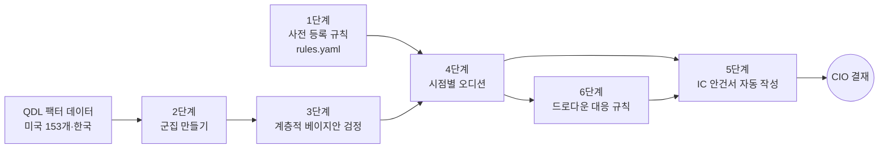

# 실습과제 — 팩터 오디션

> [!abstract] 과제 한 줄 요약
> 우리 기금의 **팩터 슬리브**에 어떤 팩터를 넣고 뺄지를 리서치 에이전트가 정하고 IC 안건서까지 쓴다. 판정 기준은 JKP(2023)의 **군집 계층적 경험적 베이지안 검정**이다. 마지막 단계에서는 팩터 겨울이 왔을 때 슬리브를 지키는 **드로다운 대응 규칙**을 더한다.

> [!info] 이 과제가 SDAM의 어느 부분인가
> 자율주행 자산운용(SDAM)에서 리서치 에이전트는 새 리서치와 데이터를 보고 운용 방식을 바꾸자고 제안하는 역할을 맡는다. 이 과제는 그 역할 하나를 작동하는 MVP로 만든다. 에이전트가 제안하고, 사전에 등록한 규칙이 제안을 걸러 내고, CIO는 안건서를 읽고 결재만 한다.

> [!important] 수강생이 하는 일과 하지 않는 일
> **이 과제에서 수강생은 코드를 직접 짜지 않는다. 모든 구현은 Claude Code에게 시킨다.**
>
> | 수강생이 하는 일 | 수강생이 하지 않는 일 |
> |---|---|
> | 지시문(P0~P7)을 붙여넣고, 결과가 이상하면 지시문을 고쳐 다시 시킨다 | 코드를 직접 작성하거나 고친다 |
> | 체크포인트 숫자와 그림이 그럴듯한지, 검산 테스트가 통과했는지 확인한다 | 오류 메시지를 직접 해결한다 (Claude Code에게 해결하라고 시킨다) |
> | 에이전트가 시점 규칙이나 사전 등록 규칙을 어겼는지 잡아낸다 | 파일을 직접 내려받거나 열어서 정리한다 |
> | 판단 문제에 답하고, `rules.yaml`의 기준을 팀이 정한다 | 에이전트가 낸 숫자를 확인 없이 보고서에 옮긴다 |
> | 에이전트가 쓴 안건서를 CIO 입장에서 승인하거나 반려한다 | |
>
> 각 단계의 **설계도 코드**는 두 가지 용도로만 쓴다. 하나는 Claude Code가 무엇을 만들어야 하는지 보여 주는 것이고, 다른 하나는 Claude Code가 만든 코드를 읽을 때 대조할 기준이다. 수식과 코드가 어긋나면 그것을 찾아 Claude Code에게 고치라고 시키는 것이 수강생의 일이다.



---

## 0. 기본 지식

### 0.1 팩터 슬리브란 무엇인가

**슬리브(sleeve)** 는 전체 기금 안에서 특정 전략이나 운용사에 따로 떼어 맡긴 한 덩어리 자금이다. 옷의 소매처럼 몸통(전체 포트폴리오)에 붙어 있지만 따로 구분되는 부분이라는 뜻에서 나온 말이다. 슬리브마다 운용 방식, 벤치마크, 위험 한도, 성과평가가 따로 정해진다. 비슷한 말로 위탁 계약 단위를 뜻하는 맨데이트(mandate)나 버킷(bucket)도 쓰지만, 슬리브는 전체 포트폴리오의 일부로 관리된다는 점을 강조할 때 주로 쓴다.

> [!example] 예시 — 기금 1,000조 원, 해외주식 35%(350조 원)
> | 슬리브 | 규모 | 운용 방식 |
> |---|---|---|
> | 패시브 인덱스 슬리브 | 300조 원 | MSCI 지수를 그대로 따라간다 |
> | 액티브 위탁 슬리브 | 40조 원 | 외부 운용사 여러 곳에 나눠 맡긴다 |
> | **팩터 슬리브** | **10조 원** | 가치, 모멘텀, 수익성 같은 팩터 전략에 투자한다 |
>
> 이 과제는 마지막 줄, 팩터 슬리브 안에 어떤 팩터를 담을지를 정한다.

연기금은 주식 자산 가운데 일부를 **팩터 슬리브**(factor sleeve)로 떼어 운용한다. 가치, 모멘텀, 수익성처럼 장기적으로 보상받는다고 알려진 특성에 체계적으로 노출되도록 만든 포트폴리오 묶음이다. 실무에서는 스마트베타 인덱스를 사거나, 규칙 기반 팩터 위탁을 주거나, 내부에서 직접 운용한다.

이 과제의 질문은 **"어떤 팩터를 슬리브에 넣고, 언제 빼는가"** 이다.

### 0.2 팩터 동물원과 다중검정 문제

학계가 보고한 팩터는 수백 개다. 이를 **팩터 동물원**(factor zoo, Cochrane 2011)이라 부른다.

- 팩터 하나를 $t \ge 1.96$으로 검정하면 우연히 유의하게 나올 확률이 5%다.
- 153개를 검정하면 진짜 효과가 하나도 없어도 평균 7~8개가 유의하게 나온다.
- 그래서 Harvey·Liu·Zhu(2016)는 기준을 $t \ge 3$으로 올리자고 했다.
- 반대로 JKP(2023)는 기준을 올리는 대신 **팩터들이 서로 닮았다는 정보**를 쓰면 된다고 보았다. 이것이 계층적 베이지안 검정이다.

### 0.3 경험적 베이지안과 수축(shrinkage)

추정한 알파 $\hat\alpha$에는 잡음이 섞여 있다. 크게 나온 알파일수록 잡음 덕을 봤을 가능성이 크다. 베이지안 사고는 다음과 같다.

$$
\underbrace{\text{사후 평균}}_{\text{믿을 만한 알파}}
= \underbrace{\kappa}_{\text{신뢰 비중}}\times \underbrace{\hat\alpha}_{\text{추정 알파}} + (1-\kappa)\times \underbrace{\text{사전 평균}}_{\text{비슷한 팩터들의 평균}},
\qquad
\kappa = \frac{\text{진짜 알파의 분산}}{\text{진짜 알파의 분산} + \text{추정오차 분산}}
$$

- 추정오차가 클수록 $\kappa$가 작아져 사전 평균 쪽으로 더 많이 **수축**한다.
- **경험적** 베이지안은 사전분포의 분산을 연구자가 정하지 않고 데이터에서 추정한다. 그래서 주관이 덜 들어간다.

### 0.4 왜 "군집 계층"인가

가치 팩터 10여 개는 서로 상관이 높다. 그중 하나가 좋으면 나머지도 좋을 가능성이 크다. JKP는 팩터를 13개 군집(theme)으로 묶고, 알파를 세 층으로 나눴다.

$$
\underbrace{\alpha_i}_{\text{팩터 }i\text{의 진짜 알파}}
= \underbrace{\alpha_o}_{\text{전체 평균}}
+ \underbrace{c_{j(i)}}_{\text{군집 효과}}
+ \underbrace{w_i}_{\text{팩터 고유 효과}},
\qquad
c_j \sim N(0,\tau_c^2),\quad w_i \sim N(0,\tau_w^2)
$$

- $\tau_c$가 크면 군집마다 성과가 크게 다르다는 뜻이다.
- $\tau_w$가 크면 같은 군집 안에서도 팩터마다 성과가 다르다는 뜻이다.
- 같은 군집의 다른 팩터들이 좋으면, 표본이 짧은 팩터도 그 덕을 본다. 이를 **정보 공유**라 한다.

JKP는 이 방법으로 미국 팩터의 **82.4%** 가 재현된다고 보고했다. 단순 $t \ge 3$ 기준보다 훨씬 높은 비율이다.

### 0.5 사전 등록(pre-registration)

판정 규칙을 데이터를 보기 **전에** 정하고 고치지 못하게 잠가 두는 것이다. 결과를 보고 규칙을 바꾸면 다중검정 문제가 다시 생긴다. 에이전트에게 맡길 때는 더 중요하다. 에이전트는 사람보다 빠르게 많은 규칙을 시도할 수 있기 때문이다. 이 과제에서는 Claude Code의 **훅(hook)** 으로 규칙 파일 수정을 기계적으로 막는다.

### 0.6 드로다운(drawdown)

$$
\underbrace{DD_t}_{\text{드로다운}} = \frac{\underbrace{V_t}_{\text{현재 누적가치}}}{\underbrace{\max_{s\le t} V_s}_{\text{과거 최고점}}} - 1
$$

통계적으로는 아직 좋은 팩터라도 3년 연속 손실을 내면 위원회가 버티기 어렵다. 2018~2020년 가치 팩터의 긴 손실(**Value 겨울**)이 대표적이다. 6단계에서는 "통계 판정"과 "위원회가 버틸 수 있는 손실"을 함께 다루는 규칙을 만든다.

---

## 과제 구성 한눈에

| 단계 | 할 일 | 산출물 | 배점 |
|---|---|---|---|
| 0 | 작업 환경을 만들고 데이터를 확인한다 | `CLAUDE.md`, 데이터 점검표 | 5 |
| 1 | 슬리브 규정과 판정 규칙을 사전 등록하고 잠근다 | `rules.yaml`, 수정 차단 훅 | 10 |
| 2 | 153개 팩터를 13개 군집으로 묶는다 | `clusters.csv`, 덴드로그램 | 10 |
| 3 | 계층적 경험적 베이지안 검정 엔진을 만든다 | `eb.py`, 재현율 표 | 25 |
| 4 | 2000·2005·2010·2015·2020년 시점으로 돌아가 오디션을 연다 | 세 규칙의 채점표 | 20 |
| 5 | 에이전트가 IC 안건서를 쓴다 | `IC_2020-12.md` | 10 |
| 6 | 드로다운 대응 규칙을 만들고 Value 겨울에 시험한다 | 대응 규칙 성과 비교표 | 20 |
| 가산 | 월간 루프로 묶어 SDAM 모듈로 만든다 | `run_monthly.py` | +10 |

> [!warning] 모든 단계의 공통 규칙
> 1. **시점 규칙.** 날짜 $d$에 내린 결정에는 $d$까지의 데이터만 쓴다. 군집, 사전분포의 분산, 상관 모두 그 시점까지의 데이터로 다시 추정한다.
> 2. **규칙 잠금.** 1단계에서 등록한 `rules.yaml`은 이후 고치지 않는다. 고치고 싶으면 `rules_v2.yaml`을 새로 만들고 보고서에 바꾼 이유와 바꾼 날짜를 적는다.
> 3. **Claude Code에게 맡긴다.** 코드 작성, 내려받기, 실행, 파일 열기, 오류 해결은 모두 Claude Code에게 시킨다. 여러분은 지시문을 붙여넣고 결과를 확인한다.

---

## 0단계 — 작업 환경과 데이터 확인 (5점)

### 준비
> [!tip] QDL을 처음 쓴다면
> 별도 문서 **`QDL_Beginner_Guide.md`**(QDL 사용 가이드)의 2장 설치와 5장 연습 1~5를 먼저 끝낸다. 팩터를 직접 만들어 본 적이 없다면 이 문서 끝의 **부록 A 팩터 복제 연습**을 먼저 해 본다. 3단계 이후가 훨씬 쉬워진다.

- BAF634 저장소(`github.com/jaepil-choi/KAIST-BAF634-2025`)를 내려받는다.
- 강의 데이터(Google Drive)를 저장소 루트의 `data/`에 넣는다. 이번 과제는 `data/factors/`만 쓴다. 특성 parquet는 필요 없다.
- 저장소 안에 `factor_audition/` 폴더를 만들어 작업한다. `QDL()`은 저장소 루트의 `data/`를 읽는다.

> [!example] Claude Code 지시문 P0
> ```
> 이 저장소(KAIST-BAF634-2025) 루트에 factor_audition/ 폴더를 만들고 다음을 해 줘.
> 1. factor_audition/CLAUDE.md 를 만든다. 내용:
>    - 이 프로젝트는 연기금 팩터 슬리브의 편입·퇴출을 판정하는 리서치 에이전트다.
>    - 데이터는 from qdl.facade import QDL 로만 읽는다. 시장 팩터 CSV만 예외로 pandas로 읽는다.
>    - rules.yaml 은 절대 수정하지 않는다. 바꾸자는 제안은 proposals/ 에 md로 쓴다.
>    - 날짜 d의 결정에는 d까지의 데이터만 쓴다.
>    - 결과 숫자는 반드시 스크립트를 실행해서 얻고, 추정해서 쓰지 않는다.
> 2. data/factors/ 안의 파일 목록을 보여 주고, usa·kor 각각에 대해
>    all_factors vw_cap 파일의 팩터 개수, 시작월, 마지막월, 결측 비율을 표로 정리해
>    factor_audition/results/data_check.md 로 저장한다.
> 3. mkt 파일의 열 이름을 확인해서 시장 초과수익률 열이 무엇인지 알려 준다.
> 오류가 나면 스스로 원인을 찾아 고친 뒤 무엇을 고쳤는지 한 줄로 알려 줘.
> ```

### Claude Code가 만들 코드의 설계도 (읽기용) — `factor_audition/data.py`

```python
from pathlib import Path
import numpy as np
import pandas as pd
from qdl.facade import QDL

q = QDL()
FDIR = Path("data/factors")

def factor_names(country):
    f = FDIR / f"[{country}]_[all_factors]_[monthly]_[vw_cap].csv"
    return sorted(pd.read_csv(f, usecols=["name"])["name"].unique())

def load_factors(country):
    """날짜×팩터 와이드, 월 수익률(소수)."""
    F = q.load_factors(country=country, dataset="factor", weighting="vw_cap",
                       factors=factor_names(country), strict=False)
    F.index = pd.to_datetime(F.index) + pd.offsets.MonthEnd(0)
    return F.sort_index()

def load_mkt(country, col):
    """시장 초과수익률. col 은 0단계에서 확인한 열 이름."""
    m = pd.read_csv(FDIR / f"[{country}]_[mkt]_[monthly]_[vw_cap].csv")
    date_col = [c for c in m.columns if c in ("eom", "date")][0]
    s = m.set_index(pd.to_datetime(m[date_col]) + pd.offsets.MonthEnd(0))[col]
    return s.sort_index()
```

> [!check] 수강생이 확인할 것
> - `results/data_check.md`에 미국과 한국의 팩터 개수, 시작월, 마지막월이 모두 있는가?
> - Claude Code가 알려 준 시장 초과수익률 열 이름을 `CLAUDE.md`에 적어 두었는가?
> - `CLAUDE.md`에 규칙 다섯 줄이 빠짐없이 들어갔는가?

> [!question] 체크포인트 0
> 미국 팩터는 몇 개이고 언제부터 있는가? 한국은 어떤가? 한국 표본이 짧다는 사실이 3단계의 추정오차와 4단계의 한국 재현 조건에 어떤 영향을 줄지 두 문장으로 예상해 적는다.

---

## 1단계 — 사전 등록: 에이전트의 헌법 (10점)

### 우리 기금의 가정 (교육용)
- 해외주식 가운데 3%를 팩터 슬리브로 운용한다. 슬리브는 **미국 팩터**로 구성하고, 한국 데이터는 "다른 시장에서도 통하는가"를 확인하는 데만 쓴다.
- 슬리브 안의 팩터는 각각 연 변동성 10%로 맞춘 뒤 같은 비중으로 담는다.
- 정기 리뷰는 매년 12월 말이다. 오디션 시점은 2000, 2005, 2010, 2015, 2020년 12월이다.

### `rules.yaml` 초안

```yaml
version: 1
registered_on: "2026-10-28"        # 등록일. 이후 수정 금지
sleeve:
  max_factors: 10                  # 슬리브 최대 팩터 수
  max_per_cluster: 2               # 군집당 최대 팩터 수
  max_pair_corr: 0.70              # 기존 편입 팩터와의 최대 상관
  vol_target_annual: 0.10
test:
  method: jkp_hierarchical_eb      # 비교용: naive_t, hlz_t3
  alpha_model: capm                # 시장에 대한 알파
  prior_mean: 0.0                  # 회의적 사전 (전체 평균 알파 0)
  n_clusters: 13
  min_months: 120                  # 최소 표본 10년
entry:                             # 편입 조건 (모두 만족)
  post_t_min: 1.96                 # 사후 평균 / 사후 표준편차
  kor_post_mean_positive: true     # 한국 표본이 10년 이상이면 한국 사후 평균도 양수
exit:                              # 퇴출 조건 (하나라도 만족)
  post_t_below: 1.00               # 편입 1.96, 퇴출 1.00 → 잦은 교체 방지
drawdown_ladder:                   # 6단계에서 채운다
  level1: -0.10
  level2: -0.20
  level3: -0.30
```

> [!tip] 편입 기준과 퇴출 기준을 다르게 둔 이유
> 같은 기준(1.96)으로 넣고 빼면, 경계 근처의 팩터가 매년 들어왔다 나갔다 한다. 위탁 운용에서는 교체할 때마다 운용사 선정, 이관, 거래 비용이 든다. 그래서 들어오기는 어렵고 나가기도 어렵게 만든다. 이를 **이력 현상**(hysteresis) 구간이라 부른다.

> [!example] Claude Code 지시문 P1
> ```
> factor_audition/rules.yaml 을 아래 내용으로 만들고 git에 커밋해 줘. (내용 붙여넣기)
> 그다음 rules.yaml 수정을 막는 Claude Code 훅을 설정해 줘.
> 1. factor_audition/scripts/guard_rules.py:
>    표준입력으로 들어오는 훅 JSON에서 tool_input.file_path 를 읽어
>    파일 이름이 rules.yaml 로 끝나면 "rules.yaml 은 사전 등록 파일이라 수정할 수 없다.
>    proposals/ 에 제안서를 써라" 를 stderr에 쓰고 exit code 2 로 끝낸다. 아니면 0.
> 2. .claude/settings.json 에 PreToolUse 훅으로 Edit 와 Write 도구에 이 스크립트를 연결한다.
> 3. 시험: rules.yaml 의 post_t_min 을 1.5로 바꿔 보라고 스스로에게 시켜서
>    차단되는지 확인하고, 차단 메시지를 results/guard_test.md 에 기록한다.
> 4. rules.yaml 의 git 커밋 해시를 results/registration.md 에 적는다.
> ```

> [!check] 수강생이 확인할 것
> - 일부러 `rules.yaml` 수정을 시켰을 때 실제로 차단되었는가? `results/guard_test.md`의 차단 메시지를 직접 읽는다.
> - `results/registration.md`의 커밋 해시가 `git log`의 해시와 같은가? 이것도 Claude Code에게 대조하라고 시킨다.
> - `rules.yaml`의 숫자는 팀이 정한 값인가? 에이전트가 임의로 바꾼 값이 없는가?

> [!question] 판단 문제 1
> 슬리브 운용역이 "2022년 이후 금리가 올라 가치 팩터가 유리하니 편입 기준을 1.5로 낮추자"고 제안했다. 이 제안을 받아들이면 무엇이 무너지는가? 그래도 시장 환경 변화를 반영하고 싶다면 어떤 절차로 반영해야 하는가? 세 문장으로 답한다.

---

## 2단계 — 군집 만들기 (10점)

### 원리
JKP는 팩터 수익률의 상관을 바탕으로 **계층적 군집 분석**(Ward 방식)을 해 13개 군집을 만들었다. 표준화한 수익률 사이의 유클리드 거리는 상관과 다음 관계가 있으므로, 상관이 높은 팩터끼리 묶인다.

$$
\underbrace{\lVert z_i - z_k \rVert}_{\text{표준화 수익률 사이의 거리}} = \sqrt{2T\,(1-\underbrace{\rho_{ik}}_{\text{상관}})}
$$

> [!note] 공식 라벨과의 대조
> JKP는 13개 군집 이름(가치, 모멘텀, 수익성, 저위험 등)을 공개했다. `data/factors/`의 `all_themes` 파일에 군집별 수익률이 있으므로, 여러분이 만든 군집과 공식 군집을 상관으로 대조할 수 있다. 공식 군집 소속표를 구할 수 있으면 그것과 일치율(ARI)도 구한다.

### Claude Code가 만들 코드의 설계도 (읽기용) — `factor_audition/clusters.py`

```python
from scipy.cluster.hierarchy import linkage, fcluster, dendrogram

def make_clusters(F, end, n_clusters=13, min_months=120):
    """end 까지의 데이터만으로 군집을 만든다."""
    W = F.loc[:end]
    W = W.loc[:, W.notna().sum() >= min_months]
    W = W.dropna(how="any")                 # 공통 표본 (짧으면 min_months 조정)
    Z = (W - W.mean()) / W.std()
    L = linkage(Z.T.values, method="ward")
    lab = fcluster(L, t=n_clusters, criterion="maxclust")
    return pd.Series(lab, index=W.columns, name="cluster"), L
```

> [!example] Claude Code 지시문 P2
> ```
> clusters.py 를 완성하고 미국 전체 표본으로 13개 군집을 만들어 줘.
> 1. 덴드로그램을 results/fig_dendrogram.png 로 저장한다.
> 2. 각 군집에 속한 팩터 이름을 보고 군집 이름(가치, 모멘텀 등)을 붙여 clusters.csv 로 저장한다.
>    이름은 네가 추측하지 말고, 군집 평균 수익률과 all_themes 파일의 13개 테마 수익률의
>    상관이 가장 높은 테마 이름을 붙인다. 그 상관값도 함께 적는다.
> 3. 2000년 12월까지의 데이터로도 군집을 만들어, 전체 표본 군집과 몇 개 팩터가 다른 군집으로
>    갔는지 표로 정리한다.
> ```

> [!check] 수강생이 확인할 것
> - 군집이 13개이고, 각 군집 이름에 `all_themes`와의 상관값이 붙어 있는가?
> - 상관값이 0.5보다 낮은 군집이 있다면, 이름이 맞는지 Claude Code에게 다시 설명하라고 시켰는가?
> - 2000년 군집을 만들 때 2001년 이후 데이터가 쓰이지 않았는가? `end` 인자가 실제로 쓰였는지 Claude Code에게 보여 달라고 한다.

> [!question] 판단 문제 2
> 2000년까지의 데이터로 만든 군집과 전체 표본 군집이 다르다. 오디션에서 2000년 결정에 전체 표본 군집을 쓰면 왜 반칙인가? 군집이 바뀌는 것이 베이지안 검정 결과에 어떤 경로로 영향을 주는지 설명한다.

---

## 3단계 — 계층적 경험적 베이지안 검정 엔진 (25점, 핵심)

### 원리

**(1) 팩터 정규화와 CAPM 알파.** 팩터마다 연 변동성 10%로 맞춘 뒤 시장에 회귀해 알파를 구한다.

$$
\underbrace{f_{i,t}}_{\text{팩터 수익률}} = \underbrace{\hat\alpha_i}_{\text{추정 알파}} + \beta_i\,\underbrace{m_t}_{\text{시장 초과수익률}} + e_{i,t},
\qquad
\underbrace{\hat\Sigma}_{\text{잔차 공분산}} = \operatorname{Cov}(e_t)
$$

**(2) 측정 모형과 사전분포.**

$$
\hat\alpha = \alpha + \varepsilon,\quad \varepsilon\sim N\!\left(0,\ \tfrac{1}{T}\hat\Sigma\right),
\qquad
\alpha = \alpha_o\iota + \underbrace{M}_{\text{군집 소속 행렬}}c + w
$$

$M$은 $N\times J$ 행렬이고, 팩터 $i$가 군집 $j$에 속하면 $M_{ij}=1$이다. 따라서 진짜 알파의 사전 공분산은 다음과 같다.

$$
\underbrace{\Omega}_{\text{진짜 알파의 공분산}} = \tau_c^2\,MM^{\top} + \tau_w^2\,I
$$

**(3) 경험적 베이지안 추정.** $\hat\alpha$의 주변분포 $N\!\left(\alpha_o\iota,\ \Omega+\tfrac1T\hat\Sigma\right)$의 우도를 최대화해 $\tau_c,\tau_w$를 추정한다.

$$
\max_{\tau_c,\tau_w}\ -\tfrac12\log\left|\Omega+\tfrac1T\hat\Sigma\right| - \tfrac12(\hat\alpha-\alpha_o\iota)^{\top}\left(\Omega+\tfrac1T\hat\Sigma\right)^{-1}(\hat\alpha-\alpha_o\iota)
$$

**(4) 사후분포와 판정.**

$$
\underbrace{\mathbb{E}[\alpha\mid\hat\alpha]}_{\text{사후 평균}} = \alpha_o\iota + \Omega\left(\Omega+\tfrac1T\hat\Sigma\right)^{-1}(\hat\alpha-\alpha_o\iota),
\qquad
\underbrace{\operatorname{Var}[\alpha\mid\hat\alpha]}_{\text{사후 공분산}} = \Omega - \Omega\left(\Omega+\tfrac1T\hat\Sigma\right)^{-1}\Omega
$$

$$
\text{사후 } t_i = \frac{\text{사후 평균}_i}{\text{사후 표준편차}_i}\ \ge 1.96 \ \Rightarrow\ \text{재현(편입 후보)}
$$

### Claude Code가 만들 코드의 설계도 (읽기용) — `factor_audition/eb.py`

```python
import numpy as np
import pandas as pd
from scipy.optimize import minimize

def prepare(F, mkt, end, min_months=120):
    W = F.loc[:end]
    W = W.loc[:, W.notna().sum() >= min_months].dropna()
    W = W * (0.10 / np.sqrt(12)) / W.std()               # 연 변동성 10%
    m = mkt.reindex(W.index)
    X = np.c_[np.ones(len(W)), m.values]
    B = np.linalg.lstsq(X, W.values, rcond=None)[0]       # 2×N
    E = W.values - X @ B
    T = len(W)
    a_hat = pd.Series(B[0], index=W.columns)
    S = np.cov(E, rowvar=False) / T                       # Σ/T
    se = np.sqrt(np.diag(S))
    return a_hat, S, pd.Series(a_hat.values / se, index=W.columns), T

def eb_fit(a_hat, S, clusters, alpha0=0.0):
    names = a_hat.index
    lab = clusters.reindex(names)
    M = pd.get_dummies(lab).values.astype(float)          # N×J
    N = len(names); MM = M @ M.T; e = a_hat.values - alpha0

    def negll(log_tau):
        tc2, tw2 = np.exp(2 * log_tau)
        V = tc2 * MM + tw2 * np.eye(N) + S
        sign, logdet = np.linalg.slogdet(V)
        return 0.5 * (logdet + e @ np.linalg.solve(V, e))

    res = minimize(negll, x0=np.log([1e-3, 1e-3]), method="Nelder-Mead")
    tc2, tw2 = np.exp(2 * res.x)
    Om = tc2 * MM + tw2 * np.eye(N)
    # [Claude Code가 채울 부분]: K = Ω(Ω+S)⁻¹, 사후 평균 = alpha0 + K e, 사후 공분산 = Ω − K Ω
    # [Claude Code가 채울 부분]: 사후 표준편차, 사후 t, P(α>0) = Φ(사후평균/사후표준편차) 를 DataFrame으로 반환
    ...
```

> [!example] Claude Code 지시문 P3
> ```
> eb.py 의 채울 부분을 위 수식대로 완성해 줘. 그리고 다음을 실행해 results/eb_full.md 에 정리해 줘.
> 1. 미국 전체 표본: τ_c, τ_w(연율 %), 재현율 = 사후 t ≥ 1.96 인 팩터 비율.
>    같은 표본에서 단순 t ≥ 1.96 비율, t ≥ 3 비율도 함께 표로 보여 준다.
>    JKP 논문의 미국 재현율 82.4%와 비교하고, 차이가 나면 이유 후보를 적는다.
> 2. 그림 하나: x축 OLS 알파, y축 사후 평균, 점 색은 군집. 45도선을 함께 그린다.
>    results/fig_shrinkage.png
> 3. 같은 과정을 한국에 대해 반복한다. 한국은 표본이 짧으니 min_months 를 바꾸지 말고
>    조건을 만족하는 팩터 수가 몇 개인지 먼저 보고한다.
> 4. 검산: τ_c=τ_w=0 이면 사후 평균이 모두 0, τ가 매우 크면 사후 평균이 OLS 알파와 같아지는지
>    단위 테스트를 tests/test_eb.py 로 만들어 돌린다.
> ```

> [!check] 수강생이 확인할 것
> - `tests/test_eb.py`가 통과했는가? 통과 화면을 보고서에 붙인다.
> - 설계도의 사후 평균과 사후 공분산 식이 코드에 그대로 들어갔는가? 수식과 코드를 한 줄씩 대조하라고 Claude Code에게 시키고 그 답을 읽는다.
> - $\tau_c$와 $\tau_w$가 0이나 비현실적으로 큰 값(연 20% 이상)으로 나오지 않았는가?
> - 재현율이 JKP의 82.4%와 크게 다르면, Claude Code가 적은 차이의 이유가 납득되는가?

> [!question] 체크포인트 3
> 1. 수축 그림에서 45도선보다 0 쪽으로 가장 많이 끌려온 팩터 세 개는 어느 군집인가? 그 군집의 다른 팩터들은 성과가 어땠는가?
> 2. $\tau_c$와 $\tau_w$ 가운데 어느 쪽이 큰가? 이 결과가 "팩터를 고를 때 군집을 먼저 고르고 그 안에서 팩터를 골라야 하는가"에 주는 함의를 쓴다.

> [!question] 판단 문제 3
> 표본이 12년뿐인 새 팩터가 단순 $t=2.4$로 나왔는데 사후 $t=1.7$로 떨어졌다. 같은 군집의 팩터들은 대부분 알파가 작다. 운용역은 "새 팩터는 기존 팩터와 다르다"며 편입을 주장한다. 계층 모형의 논리로 반박하고, 운용역의 주장이 맞으려면 데이터에서 무엇이 보여야 하는지 쓴다.

---

## 4단계 — 시점별 오디션과 채점 (20점)

### 원리
2000, 2005, 2010, 2015, 2020년 12월에 그 시점까지의 데이터만으로 2~3단계를 다시 하고, 규칙에 따라 슬리브를 바꾼다. 다음 5년의 실제 성과로 판정 규칙 세 가지를 채점한다.

| 규칙 | 편입 조건 | 퇴출 조건 |
|---|---|---|
| 가. 단순 기준 | OLS $t \ge 1.96$ | OLS $t < 1.00$ |
| 나. 상향 기준 (Harvey·Liu·Zhu) | OLS $t \ge 3.0$ | OLS $t < 1.00$ |
| 다. 계층 베이지안 (JKP) | 사후 $t \ge 1.96$이고 한국 사후 평균이 양수 | 사후 $t < 1.00$ |

세 규칙 모두 `rules.yaml`의 슬리브 제약(최대 10개, 군집당 2개, 상관 0.7 이하)을 똑같이 적용한다. 후보가 많으면 점수(가·나는 OLS $t$, 다는 사후 평균)가 높은 순서로 채운다.

### Claude Code가 만들 코드의 설계도 (읽기용) — `factor_audition/audition.py`

```python
REVIEWS = pd.to_datetime(["2000-12-31", "2005-12-31", "2010-12-31",
                          "2015-12-31", "2020-12-31"])

def review(rule, d, current, F_us, F_kr, mkt_us, mkt_kr, rules):
    """날짜 d의 결정: (새 슬리브, 결정 기록 DataFrame) 반환."""
    clus = make_clusters(F_us, d)[0]
    a, S, t_ols, T = prepare(F_us, mkt_us, d)
    post = eb_fit(a, S, clus)                      # 규칙 다에서만 사용
    # [Claude Code가 채울 부분] 1: 현재 편입 팩터 중 퇴출 조건 해당 팩터를 뺀다
    # [Claude Code가 채울 부분] 2: 편입 후보를 점수순으로 보며 군집당 한도·상관 한도·총 한도를 확인해 채운다
    #         상관은 d 까지의 데이터로 계산한다
    # [Claude Code가 채울 부분] 3: 팩터마다 (결정, 사유) 를 기록한다. 사유는 문장으로 쓴다.
    #         예: "사후 t 1.42로 편입 기준 1.96에 못 미친다"
    ...

def sleeve_return(members, F, start, end):
    W = F.loc[start:end, members]
    W = W * (0.10 / np.sqrt(12)) / F.loc[:start, members].std()   # 비율은 d 시점 추정치
    return W.mean(axis=1)
```

> [!example] Claude Code 지시문 P4
> ```
> audition.py 의 채울 부분을 완성하고 세 규칙(가·나·다)으로 2000~2020년 오디션을 돌려 줘.
> 각 리뷰 다음 날부터 다음 리뷰까지(2020년은 마지막 데이터 월까지)의 성과로 채점한다.
> results/audition_scorecard.md 에 다음 표를 만든다.
>  - 규칙별 슬리브 연 수익률, 변동성, 샤프 비율, 시장 대비 CAPM 알파와 t값
>  - 규칙별 편입 팩터 수, 리뷰마다 교체한 팩터 수(회전)
>  - 오탐 비율: 편입한 팩터 가운데 다음 5년 CAPM 알파가 음수였던 비율
>  - 리뷰 시점별 편입·퇴출 명단 (규칙 다)
> 누적수익률 그림 results/fig_audition.png 를 세 규칙과 시장으로 그린다.
> 마지막으로, 규칙 다에서 2020년에 편입된 팩터를 군집별로 세어 표로 만든다.
> ```

> [!check] 수강생이 확인할 것
> - 리뷰 날짜마다 군집, 알파, 상관이 그 날짜까지의 데이터로 다시 계산되었는가? 2000년 리뷰 기록에 2001년 이후 날짜가 나오면 반칙이다.
> - 세 규칙에 같은 슬리브 제약(최대 10개, 군집당 2개, 상관 0.7)이 적용되었는가?
> - 결정 사유가 완결된 문장으로 적혀 있는가?

> [!question] 체크포인트 4
> 1. 세 규칙 가운데 오탐 비율이 가장 낮은 것은? 회전은 어느 규칙이 가장 큰가?
> 2. 규칙 나($t\ge3$)는 편입 팩터 수가 적어 군집 분산이 떨어질 수 있다. 실제로 그랬는가?

> [!question] 판단 문제 4
> 결과를 보니 규칙 다의 샤프 비율이 규칙 가보다 약간 낮았지만 오탐 비율과 회전은 훨씬 낮았다. 운용위원회에 규칙 다를 표준으로 추천할 것인가? 연기금이 단기 성과보다 무엇을 더 중시해야 하는지를 근거로 세 문장으로 답한다. 결과가 반대였다면 결론이 바뀌는지도 쓴다.

---

## 5단계 — 에이전트가 IC 안건서를 쓴다 (10점)

### 목표
2020년 12월 리뷰 결과를 바탕으로 리서치 에이전트가 IC 안건서를 쓴다. CIO가 숫자 계산 없이 읽고 결재할 수 있어야 한다.

### 안건서 형식 (`templates/ic_agenda.md`)

```markdown
# 팩터 슬리브 정기 리뷰 안건 — {리뷰일}

## 한 장 요약
- 결정할 것: {편입 n개, 퇴출 m개, 유지 k개}
- 에이전트 권고: {승인 / 조건부 승인}
- 판정 근거: rules.yaml v{버전} (등록 커밋 {해시})

## 무엇을 결정하는가
| 안건 | 팩터 | 군집 | 사후 알파(연 %) | 사후 t | 한국 사후 알파 | 결정 |
...

## 왜 이렇게 판정했는가 (팩터별 한 문단, 문장으로)
## 탈락한 유력 후보와 탈락 사유
## 슬리브 위험 점검 (군집별 위험 기여, 최대 상관 쌍)
## 드로다운 단계 현황 (6단계 결과)
## 규칙 변경 제안 (있다면 proposals/ 링크)
```

> [!example] Claude Code 지시문 P5
> ```
> templates/ic_agenda.md 형식으로 2020년 12월 리뷰 안건서를 results/IC_2020-12.md 로 써 줘.
> 규칙:
> - 모든 숫자는 results/ 의 실행 결과에서 가져오고, 문서 끝에 숫자 출처 파일 목록을 적는다.
> - 결정 사유는 "명사·명사" 나열이 아니라 완결된 문장으로 쓴다.
> - 단순 t 로는 편입됐을 팩터가 계층 베이지안에서 탈락한 경우를 따로 한 절로 설명한다.
> - rules.yaml 에 없는 기준을 새로 만들어 판정하지 않는다. 필요하다고 판단되면
>   proposals/2020-12_rule_change.md 에 제안서로만 쓴다.
> 다 쓰고 나면 안건서의 숫자 다섯 개를 골라 결과 파일과 대조한 검증표를 함께 보여 줘.
> ```

> [!check] 수강생이 확인할 것
> - Claude Code가 보여 준 숫자 대조표에서 다섯 개가 모두 일치하는가?
> - `rules.yaml`에 없는 기준으로 판정한 문장이 안건서에 있는가? 있다면 지우라고 시킨다.
> - CIO로서 이 안건서만 읽고 결재할 수 있는가? 설명 없이 나온 용어가 있으면 고치라고 시킨다.

> [!question] 판단 문제 5
> 에이전트가 안건서 끝에 "모멘텀 군집은 최근 5년 성과가 좋으니 군집 한도를 3개로 늘리자"는 제안을 썼다. 이 제안을 CIO가 승인한다면 어떤 절차를 거쳐야 사전 등록 원칙을 지킬 수 있는가? 에이전트가 이런 제안을 하는 것 자체는 바람직한가?

---

## 6단계 — 드로다운 대응 규칙: 팩터 겨울을 버티는 법 (20점)

### 왜 필요한가
베이지안 사후분포는 천천히 움직인다. 40년 표본에서 2년 손실은 사후 평균을 조금밖에 바꾸지 못한다. 통계적으로는 옳은 태도지만, 위원회와 수익자는 2~3년 손실을 견디기 어렵다. 그래서 **통계 판정은 그대로 두고, 손실 구간에서 누가 무엇을 언제 하는지를 미리 정해 두는** 규칙이 필요하다.

### 대응 단계 (교육용)

| 단계 | 진입 조건 (슬리브 또는 팩터 드로다운) | 하는 일 |
|---|---|---|
| 1단계 | −10% 이하 | 월간 보고서에 원인 분석을 싣는다. 비중은 바꾸지 않는다 |
| 2단계 | −20% 이하 | 그 시점까지의 데이터로 3단계 검정을 다시 돌려 $P(\alpha>0)$를 IC에 보고한다 |
| 3단계 | −30% 이하 | $P(\alpha>0)\ge 0.90$이면 비중을 유지하고 위원회에 설명서를 낸다. 미만이면 위험을 절반으로 줄인다 |
| 회복 | 고점 대비 −10% 위로 회복 | 줄인 위험을 원래대로 되돌린다 |

- **퇴출은 하지 않는다.** 퇴출은 정기 리뷰의 사후 $t<1.00$ 조건으로만 한다. 손실이 컸다는 이유만으로 빼면 저점에서 팔게 된다.
- $P(\alpha>0)=\Phi\!\left(\dfrac{\text{사후 평균}}{\text{사후 표준편차}}\right)$이고 $\Phi$는 표준정규분포의 누적분포함수다.

### 시험할 구간
- **Value 겨울**: 가치 군집 팩터들과 가치 군집이 포함된 슬리브, 2017.1~2021.12
- **모멘텀 붕괴**: 모멘텀 군집, 2009.3~2009.12
- 대조군 정책 두 가지: 손실과 무관하게 **그대로 보유**, 2단계에서 **기계적으로 전량 매도**

### Claude Code가 만들 코드의 설계도 (읽기용) — `factor_audition/ladder.py`

```python
def drawdown(r):
    v = (1 + r).cumprod()
    return v / v.cummax() - 1

def run_ladder(r, prob_fn, rules):
    """r: 월 수익률(정규화된 팩터 또는 슬리브), prob_fn(d) -> d 시점 P(α>0)."""
    scale, log = 1.0, []
    v, peak = 1.0, 1.0
    for d, x in r.items():
        v *= 1 + scale * x
        peak = max(peak, v)
        dd = v / peak - 1
        # [Claude Code가 채울 부분]: dd 가 각 단계 기준을 처음 넘는 달에 행동을 결정한다
        #       3단계: p = prob_fn(d) 로 유지(scale=1) 또는 절반(scale=0.5)
        #       회복: dd > -0.10 이면 scale=1
        #       log 에 (날짜, 단계, 드로다운, P(α>0), 행동, 사유 문장) 를 남긴다
        ...
    return pd.Series(...), pd.DataFrame(log)
```

> [!warning] 드로다운 계산의 주의점
> 위험을 줄인 뒤의 드로다운은 줄인 포트폴리오 기준으로 계속 잰다. 대응 규칙의 성과와 대조군 성과는 같은 기간, 같은 연 변동성 10% 기준에서 비교한다.

> [!example] Claude Code 지시문 P6
> ```
> ladder.py 의 채울 부분을 완성하고 rules.yaml 의 drawdown_ladder 기준으로 실행해 줘.
> prob_fn(d) 는 eb.py 를 d 시점 데이터로 다시 돌려 해당 팩터의 P(α>0)를 돌려준다.
> 1. Value 겨울(2017.1~2021.12): be_me 팩터와 가치 군집 평균, 그리고 2015년 리뷰의
>    규칙 다 슬리브에 대해 세 정책(대응 규칙 / 그대로 보유 / 2단계 전량 매도)의
>    누적수익률, 최대 드로다운, 2021년 말 회복 정도를 표로 비교한다.
> 2. 모멘텀 붕괴(2009.3~2009.12)도 같은 방식으로 비교한다.
> 3. 각 달의 P(α>0) 경로를 그림으로 그린다. 2018~2020년에 P가 얼마나 움직였는지 숫자로 적는다.
> 4. 3단계에 진입한 달마다 위원회 설명서 초안을 results/ladder_memo_YYYY-MM.md 로 쓴다.
>    설명서는 "왜 지금 팔지 않는가"를 사후분포 숫자와 함께 문장으로 설명한다.
> 결과는 results/ladder_report.md 로 정리한다.
> ```

> [!check] 수강생이 확인할 것
> - 3단계에 진입한 달의 $P(\alpha>0)$가 그 달까지의 데이터로 계산되었는가?
> - 세 정책이 같은 기간, 같은 연 변동성 10% 기준으로 비교되었는가?
> - 손실만으로 팩터를 퇴출한 기록이 없는가? 있다면 규칙 위반이다.
> - 설명서가 "왜 지금 팔지 않는가"를 숫자와 함께 설명하는가?

> [!question] 체크포인트 6
> 1. Value 겨울 동안 가치 팩터의 $P(\alpha>0)$는 얼마에서 얼마로 움직였는가? 이 변화 폭이 작은 이유를 3단계 수식의 $T$와 연결해 설명한다.
> 2. 세 정책 가운데 2021년 말 기준 누적 성과가 가장 좋은 것은? 최대 드로다운이 가장 얕은 것은? 둘이 다르다면 어느 쪽을 택할지 쓴다.

> [!question] 판단 문제 6
> 2020년 9월, 가치 슬리브가 3단계에 들어갔고 $P(\alpha>0)=0.93$이라 규칙대로 유지했다. 한 위원이 "통계가 맞다는 것은 알지만 국회 국정감사가 다음 달이다"라며 축소를 요구한다. 규칙을 지킬 때와 예외를 둘 때 각각 기금이 잃는 것을 쓰고, 이런 압력을 미리 줄이려면 IPS에 무엇을 적어 두었어야 했는지 제안한다.

---

## 가산 단계 — 월간 루프로 묶어 SDAM 모듈로 만들기 (+10점)

리서치 에이전트가 매월 말 스스로 돌도록 묶는다.

> [!example] Claude Code 지시문 P7
> ```
> run_monthly.py 를 만들어 줘. 인자로 기준월(YYYY-MM)을 받는다.
> 1. 그 달까지의 데이터로 드로다운 단계를 점검하고, 2단계 이상이면 eb.py 를 다시 돌린다.
> 2. 12월이면 정기 리뷰(audition.review, 규칙 다)를 돌린다.
> 3. 안건서(5단계 형식)와 드로다운 설명서(6단계)를 results/YYYY-MM/ 에 쓴다.
> 4. rules.yaml 의 커밋 해시가 registration.md 와 다르면 실행을 멈추고 경고한다.
> 5. 2018-01 부터 2021-12 까지 매월 돌려 결과 폴더 목록과, 행동이 발생한 달의 요약표를 보여 준다.
> ```

> [!question] 판단 문제 7 (가산)
> 이 모듈을 SDAM의 다른 에이전트(자산배분, 리스크, 성과평가)와 연결한다면, 리서치 에이전트가 내린 편입 결정을 리스크 에이전트가 거부할 수 있어야 하는가? 거부할 수 있다면 어떤 조건에서인지, 그리고 최종 결정권을 왜 CIO에게 남겨야 하는지 쓴다.

---

## 제출물

1. `factor_audition/` 폴더 전체 (코드, `rules.yaml`, `results/`, `tests/`)
2. `report.md` 또는 PDF, 6쪽 이내 — 체크포인트 답, 판단 문제 답, 주요 그림 4장(수축 그림, 오디션 누적수익률, $P(\alpha>0)$ 경로, 드로다운 정책 비교)
3. `IC_2020-12.md` 안건서와 3단계 설명서 한 편 이상
4. Claude Code 작업 기록 1~2쪽 — 단계마다 처음 지시문과 고친 지시문, 에이전트가 틀린 곳과 그것을 어떻게 알아챘는지 적는다. 코드를 직접 고친 부분이 있다면 무엇을 왜 고쳤는지도 함께 적는다

## 채점 기준

| 항목 | 비중 |
|---|---|
| 시점 규칙과 규칙 잠금을 지켰는가 (에이전트의 위반을 잡아냈는가 포함) | 15% |
| 계층 베이지안 엔진이 정확한가 (검산 테스트 통과, 재현율 비교) | 20% |
| 오디션 채점과 드로다운 비교가 공정한가 | 15% |
| 판단 문제의 답이 숫자 근거와 실무 논리를 갖추었는가 | 25% |
| 안건서가 CIO가 바로 결재할 수 있는 수준인가 | 10% |
| Claude Code 작업 기록 — 지시문을 어떻게 고쳤고 에이전트의 오류를 어떻게 찾았는가 | 15% |

> [!important] 점수는 결론이 아니라 근거로 매긴다
> 규칙 다가 이기든 지든 감점하지 않는다. 결과가 기대와 다를 때 그 이유를 표본 길이, 군집 변화, 한국 재현 조건 같은 구체적 요인으로 설명했는지를 본다.


---

## 부록 A — 연습 과제: FF5·모멘텀·단기 반전 팩터 복제 (BAF634 과제 1)

> [!abstract] 왜 이 연습을 하는가
> 본 과제는 JKP가 이미 만들어 둔 153개 팩터를 **고르는** 일이다. 그런데 팩터가 어떻게 **만들어지는지** 모르면 "가치 팩터의 알파가 크다"는 말이 무엇을 뜻하는지, 동일가중과 가치가중 결과가 왜 다른지 판단할 수 없다. 이 부록은 BAF634 과목의 과제 1을 그대로 가져와, 종목 특성에서 팩터 7개를 직접 만들고 정답과 맞춰 보게 한다. **채점하지 않는 연습**이며, 본 과제 0단계 전에 하는 것을 권한다.

### A.1 기본 지식 — JKP 팩터는 어떻게 만드는가

JKP(2023)는 153개 팩터를 모두 같은 규칙으로 만든다.

1. **정렬.** 매월 말 $t$에 특성 값으로 종목을 세 묶음(하위, 중간, 상위 3분의 1)으로 나눈다.
2. **브레이크포인트.** 3분의 1 경계는 초소형주를 뺀 종목(미국은 NYSE 시가총액 20분위 이상, `size_grp`가 `micro`·`nano`가 아닌 종목)으로만 정한다. 초소형주가 경계를 흔들지 않게 하려는 것이다.
3. **가중.** 묶음 안에서 동일가중(`ew`), 시가총액가중(`vw`), 상한을 둔 시가총액가중(`vw_cap`, 시가총액을 NYSE 80분위 값에서 자른다) 세 가지로 수익률을 낸다.
4. **롱숏.** 원논문이 보고한 방향대로 상위 묶음 매수·하위 묶음 매도(또는 반대)로 팩터를 만든다.
5. **성과 시점.** $t$월 말에 만든 포트폴리오의 성과는 $t+1$월 수익률이다. 매월 다시 짠다.

$$
\underbrace{F_{t+1}}_{\text{팩터 수익률}}
= \underbrace{d}_{\text{방향 }(\pm1)}\times\Big(
\underbrace{\sum_{i\in \text{상위}} w_{i,t}\,r_{i,t+1}}_{\text{상위 3분의 1 포트폴리오}}
-\underbrace{\sum_{i\in \text{하위}} w_{i,t}\,r_{i,t+1}}_{\text{하위 3분의 1 포트폴리오}}\Big),
\qquad
\underbrace{w_{i,t}}_{\text{vw\_cap 비중}}=\frac{\min(me_{i,t},\ \bar m_t)}{\sum_{j}\min(me_{j,t},\ \bar m_t)}
$$

여기서 $\bar m_t$는 $t$월 NYSE 시가총액의 80분위 값이다. `ew`는 $w_{i,t}=1/n$, `vw`는 상한 없이 시가총액 비중을 쓴다.

> [!note] 규칙의 출처와 확인 방법
> 위 규칙은 JKP(2023)와 저장소 데이터 스펙서의 "Factor Portfolio Construction" 절을 따른 것이다. 세부(경계값을 포함하는지, 결측 처리)는 스펙서와 다를 수 있으므로 A.3의 지시문 A1에서 Claude Code에게 스펙서를 먼저 읽게 한다.

### A.2 복제할 팩터

| 팩터 | 무엇을 사고파는가 | 특성 이름 | 방향 $d$ |
|---|---|---|---|
| 규모 (SMB) | 소형주 매수, 대형주 매도 | `market_equity` | −1 |
| 가치 (HML) | 장부가 대비 시가가 높은 종목 매수 | `be_me` | +1 |
| 수익성 (RMW) | 수익성이 높은 종목 매수 | `ope_be` | +1 |
| 투자 (CMA) | 자산을 적게 늘린 종목 매수 | `at_gr1` | −1 |
| 시장 (Rm−Rf) | 전체 시장 매수 | `[usa]_[mkt]` 파일과 비교 | — |
| 모멘텀 (MOM) | 지난 1년 승자 매수, 패자 매도 | `ret_12_1` | +1 |
| 단기 반전 (STR) | 지난달 패자 매수, 승자 매도 | `ret_1_0` | −1 |

대상은 미국과 한국, 가중 방식은 `ew`, `vw`, `vw_cap` 세 가지다. 처음에는 미국 `vw_cap` 가치 팩터 하나로 시작해 맞춘 뒤 넓힌다.

### A.3 단계와 지시문

> [!example] 지시문 A1 — 규칙 확인
> ```
> 저장소의 docs/ 폴더에서 assignment_ff5.md 와 데이터 스펙서를 찾아 읽고,
> "Factor Portfolio Construction" 규칙을 표로 정리해 practice/rules_summary.md 로 저장해 줘.
> 항목: 정렬 단위, 브레이크포인트 기준 종목, 분위 수, 가중 방식별 비중 식, 롱숏 방향, 리밸런싱 주기,
> 수익률의 시점. 스펙서와 아래 내 요약이 다른 곳이 있으면 따로 표시해 줘.
> (A.1 의 다섯 줄 요약을 붙여넣는다)
> ```

> [!example] 지시문 A2 — 가치 팩터 하나 만들기
> ```
> practice/build_factor.py 를 만들어 줘. 함수 build(country, vintage, char, direction, weighting)
> 는 rules_summary.md 규칙대로 팩터 월 수익률 Series 를 돌려준다. QDL 의 load_char 로
> char, me, size_grp, ret_exc_lead1m 을 불러 쓴다.
> 먼저 미국, 2000- 빈티지, be_me, +1, vw_cap 으로 만들고 validate_factor 로 정답과 비교해
> corr, rmse, n_obs 와 누적수익률 비교 그림(practice/fig_be_me.png)을 보여 줘.
> ```

> [!example] 지시문 A3 — 맞지 않을 때 원인 찾기
> ```
> corr 가 0.95 보다 낮으면 다음을 차례로 바꿔 보며 corr 변화를 표로 보여 줘.
> 1. 날짜 맞춤: 내 팩터 날짜를 한 달 앞뒤로 옮겼을 때
> 2. 브레이크포인트: 전체 종목 기준 대 micro·nano 제외 기준
> 3. 경계 포함: 상위를 > 와 ≥ 로 정했을 때
> 4. vw_cap 상한: NYSE 80분위 대 전체 80분위
> 가장 큰 차이를 만든 원인을 한 문장으로 알려 주고, 그 설정을 build_factor.py 기본값으로 고쳐 줘.
> ```

> [!example] 지시문 A4 — 일곱 팩터 전체
> ```
> 일곱 팩터를 미국·한국, ew·vw·vw_cap 으로 모두 만들고 validate_factor 로 비교해
> practice/replication_scorecard.md 에 국가 × 가중 × 팩터별 corr, rmse 표를 만들어 줘.
> 시장 팩터는 data/factors 의 mkt 파일과 비교한다. corr 가 0.95 미만인 칸은 굵게 표시하고
> 원인 후보를 한 줄씩 적어 줘.
> ```

> [!check] 수강생이 확인할 것
> - 가치 팩터 하나라도 corr 0.95 이상으로 맞췄는가? (0.95는 이 연습의 교육용 기준이다)
> - 날짜를 한 달 옮겼을 때 corr가 크게 떨어지는가? 그렇다면 날짜 맞춤이 제대로 된 것이다.
> - 한국이 미국보다 잘 안 맞는다면, Claude Code가 적은 원인이 종목 수나 표본 길이로 납득되는가?

### A.4 생각해 볼 문제 (본 과제와 이어지는 질문)

1. **가중 방식과 슬리브 규모.** 같은 팩터인데 `ew`의 샤프 비율이 `vw_cap`보다 훨씬 높다면, 그 수익은 주로 어떤 종목에서 나오는가? 10조 원 규모 팩터 슬리브는 어느 가중 방식의 결과를 기대 수익으로 삼아야 하는가?
2. **방향의 의미.** 규모 팩터의 방향을 −1로 둔 이유는 무엇인가? 본 과제 3단계에서 어떤 팩터의 알파가 음(−)으로 나왔다면, 방향을 뒤집어 편입하는 것은 허용해야 하는가? 사전 등록 원칙과 연결해 답한다.
3. **정답이 있다는 것의 가치.** 이 연습은 정답 팩터가 있어 내 구현이 맞는지 확인할 수 있었다. 본 과제의 에이전트가 만든 숫자에는 정답이 없다. 그렇다면 에이전트의 결과를 믿기 위해 이 연습에서 배운 어떤 확인 습관을 본 과제에 가져가야 하는가?

## 참고문헌

- Jensen, T. I., Kelly, B., & Pedersen, L. H. (2023). Is there a replication crisis in finance? *Journal of Finance*, 78(5).
- Harvey, C. R., Liu, Y., & Zhu, H. (2016). … and the cross-section of expected returns. *Review of Financial Studies*.
- Cochrane, J. H. (2011). Presidential address: Discount rates. *Journal of Finance*.
- McLean, R. D., & Pontiff, J. (2016). Does academic research destroy stock return predictability? *Journal of Finance*.
- KAIST BAF634 저장소(github.com/jaepil-choi/KAIST-BAF634-2025), `docs/assignment_ff5.md` (과제 1: FF5 + Momentum + STR 팩터 복제).
- Ang, A. (2014). *Asset Management: A Systematic Approach to Factor Investing*. Oxford University Press.
- Arnott, R., Harvey, C. R., Kalesnik, V., & Linnainmaa, J. (2021). Reports of value's death may be greatly exaggerated. *Financial Analysts Journal*.
