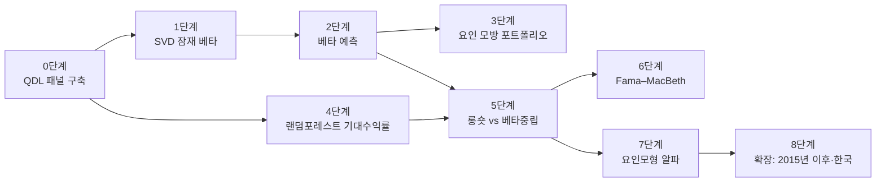

# 실습과제 — 공통요인은 정말 주식 수익률의 횡단면을 설명하는가?

> [!abstract] 과제 한 줄 요약
> 모든 잠재 공통요인의 위험을 헤지한 포트폴리오도 기대수익률 예측만으로 양(+)의 샤프 비율을 내는지 QDL 데이터로 직접 확인한다. APT가 맞다면 이 포트폴리오의 초과수익률과 샤프 비율은 0이어야 한다.

> [!info] 논문의 최신 상태 (2026.10 확인)
> - 실습 기준본은 2021년 1월 버전(SSRN 3628120, NBER SI 2021 발표본)이다. 표본은 1974–2014년이다.
> - 2022년 Jacobs Levy Center 학회 발표본은 표본을 **1974–2021년**으로 늘렸다. 이 발표본에서도 베타중립 포트폴리오의 샤프 비율은 2를 넘는다(시장 0.52, 롱숏 0.84, 베타중립 2.12·2.31).
> - Roussanov의 2025년 CV에는 아직 working paper(2021.7)로 올라 있다. 같은 저자들은 후속으로 "A machine learning-based canonical set of portfolios for testing factor models"를 진행 중이다.
> - 토론자 Guofu Zhou(WashU)는 학계에는 "소수 요인으로 큰 횡단면을 설명하기 어렵다"는 함의를, 실무에는 "요인 위험과 직교하는 알파가 존재한다"는 함의를 짚었다.
> - 출처: [NBER SI 2021 논문](https://conference.nber.org/conf_papers/f169958/f169958.pdf), [NBER 슬라이드](https://conference.nber.org/conf_papers/f169958/f169958.slides.pdf), [Jacobs Levy 2022 발표](https://jacobslevycenter.wharton.upenn.edu/wp-content/uploads/2022/09/Lopez-Lira.pdf), [Zhou 토론](https://jacobslevycenter.wharton.upenn.edu/wp-content/uploads/2022/09/Zhou.pdf), [Roussanov CV](https://faculty.wharton.upenn.edu/wp-content/uploads/2016/11/ROUSSANOVN-62714970-2025-1.pdf)

---

## 0. 기본 지식 — 이 과제를 시작하기 전에

### 0.1 차익거래가격이론(APT, Arbitrage Pricing Theory)은 무엇을 예측하는가

Ross(1976)의 APT는 종목의 초과수익률이 소수의 공통요인과 분산 가능한 개별 충격으로 나뉜다고 본다.

$$
\underbrace{r^{e}_{i,t+1}}_{\text{종목 }i\text{의 초과수익률}}
= \underbrace{\alpha_{i,t}}_{\text{알파}}
+ \underbrace{\beta_{i,t}^{\top}}_{\text{요인 노출(베타)}}\,\underbrace{f_{t+1}}_{\text{공통요인 실현값}}
+ \underbrace{\varepsilon_{i,t+1}}_{\text{개별 충격}}
\qquad \text{APT의 예측: } \alpha_{i,t}=0
$$

- **왜 알파가 0이어야 하는가.** 모든 요인 노출을 0으로 맞추고 종목 수를 충분히 늘리면 개별 충격은 서로 상쇄된다. 이런 포트폴리오는 위험이 거의 없으므로 양의 기대수익률을 낸다면 차익거래(near-arbitrage) 기회가 된다. 그래서 APT 아래에서는 이 포트폴리오의 기대수익률이 0이어야 한다(Chamberlain–Rothschild, 1983).
- **이 과제가 하는 일.** 이 예측을 그대로 시험한다. 모든 잠재요인을 헤지한 뒤에도 수익이 남는지 본다.

### 0.2 APT를 직접 검정하기 어려운 두 가지 이유

| 어려움 | 왜 어려운가 | 이 논문의 해법 |
|---|---|---|
| 공통요인을 알 수 없다 | 종목 수 $N$이 기간 $T$보다 훨씬 커서 $N\times N$ 공분산행렬을 제대로 추정할 수 없다 | 수익률 행렬의 **특이값 분해(SVD)** 로 공분산행렬을 거치지 않고 모든 잠재요인의 베타를 얻는다 |
| 기대수익률을 관측할 수 없다 | 과거에 수익률을 예측한 변수를 쓰면 데이터 스누핑 비판을 받는다 | **랜덤포레스트를 롤링 방식으로 학습**해 표본 외(out-of-sample) 예측값만 쓴다 |

### 0.3 특이값 분해와 주성분은 어떻게 연결되는가

평균을 뺀 수익률 행렬 $R$($T\times N$)을 압축 특이값 분해하면 다음과 같다.

$$
R = U S V^{\top},\qquad
\underbrace{C}_{\text{공분산행렬}} = \tfrac{1}{T}R^{\top}R = V\,\underbrace{\tfrac{S^2}{T}}_{\Lambda\ (\text{고윳값})}\,V^{\top}
$$

- $V$의 열(고유벡터)이 각 종목의 잠재요인 **베타**다. 수익률과 주성분의 공분산이 $\tfrac{1}{T}R^{\top}(US)=V\Lambda$이기 때문이다.
- $US=RV$가 잠재요인의 **실현값(주성분)** 이다.
- 따라서 $N\times N$ 공분산행렬을 직접 만들지 않아도 모든 종목의 베타를 한 번에 얻는다.

### 0.4 순수 플레이(pure-play) 포트폴리오란 무엇인가

목표로 한 노출 하나만 갖고 나머지 노출은 모두 0인 포트폴리오다. 제약을 만족하는 포트폴리오 가운데 비중이 가장 고르게 퍼진 것을 고른다.

$$
\min_{w}\ \tfrac12 w^{\top}\Omega w \quad \text{s.t.}\quad A^{\top}w = a_0
\quad\Longrightarrow\quad
w = \Omega^{-1}A\left(A^{\top}\Omega^{-1}A\right)^{-1}a_0
$$

| 기호 | 뜻 |
|---|---|
| $w$ | 종목 비중 벡터 |
| $\Omega$ | 가중행렬. 단위행렬이면 동일가중 성격, $\Omega_{ii}=1/\text{시가총액}_i$이면 가치가중 성격 |
| $A$ | 제약 특성을 열로 모은 행렬. 예: $[\iota,\ \mu,\ B]$ = [1벡터, 기대수익률, 베타] |
| $a_0$ | 목표값. 예: $[0,\ \mu_0,\ 0]$ = [비용 0, 목표 기대수익률, 베타 0] |

$\Omega=I$일 때 이 비중은 Fama–MacBeth 횡단면 회귀 계수를 만드는 비중 $A(A^{\top}A)^{-1}e_k$와 같은 꼴이다. 그래서 순수 플레이 수익률은 "다른 특성을 통제한 횡단면 기울기"로 해석된다.

### 0.5 원논문과 이 실습의 차이

| 항목 | 원논문 | 이 실습(QDL) | 결과 해석에 미치는 영향 |
|---|---|---|---|
| 베타 추정 수익률 | CRSP **일별**, 직전 252거래일 | JKP **월별**, 직전 60개월 | 추정 가능한 요인 수가 $T-1=59$개로 줄고 베타 잡음이 커진다 |
| 헤지 요인 수 | 50개(25·100개도 비슷) | 기본 20개, 30·50개로 민감도 점검 | 헤지가 덜 정밀해 베타중립 샤프 비율이 원논문보다 낮게 나올 수 있다 |
| 예측 특성 | Freyberger–Neuhierl–Weber 62개 | JKP 특성 중 40여 개 | 예측력 수준이 달라진다 |
| 표본 | 1965.7–2014.6 (분석 1974–) | `1972-` 빈티지, 최신 월까지 | 2015년 이후 구간을 **추가 표본 외 테스트**로 쓸 수 있다 |
| 유동성 필터 | NYSE 시총 20분위 미만 제외 | JKP `size_grp`의 micro·nano 제외 | 같은 기준이다(micro는 NYSE 1–20분위, nano는 1분위 미만) |

---

## 과제 구성 한눈에



| 단계 | 구현할 것 | 재현할 원논문 결과 | 배점 |
|---|---|---|---|
| 0 | QDL로 수익률·시총·특성 패널을 만들고 유니버스를 거른다 | 3.1절 데이터 | 5 |
| 1 | 60개월 창으로 SVD 베타와 설명분산 비율을 구한다 | Figure 1, 3 | 15 |
| 2 | 12개 시차 패널 회귀로 다음 달 베타를 예측한다 | Table 1, Figure 2 | 10 |
| 3 | 영비용·단위비용 요인 모방 포트폴리오를 만든다 | Table 2–5, Figure 4–5 | 15 |
| 4 | 60개월 롤링 랜덤포레스트로 기대수익률을 예측한다 | 2.5절, 부록 A.1 | 15 |
| 5 | 비헤지 롱숏과 베타중립 포트폴리오를 비교한다 | **Table 6**, Figure 6–9 | 20 |
| 6 | 예측 수익률과 베타로 Fama–MacBeth 회귀를 한다 | Table 7–8 | 10 |
| 7 | JKP 팩터에 대한 시계열 알파를 구한다 | Table 9–12 | 5 |
| 8 | 2015년 이후 구간과 한국 시장으로 확장한다 | 논문 밖 | 5 (+가산) |

> [!warning] 시점 규칙 — 모든 단계에 적용
> $t$월 말에 포트폴리오를 만들 때는 $t$월 말까지 알 수 있는 정보만 쓴다. 성과는 $t+1$월 수익률(`ret_exc_lead1m`)로 잰다. 학습 데이터의 목표 변수도 $t$월 이전에 실현된 것만 쓴다. 이 규칙을 어기면 그 단계는 0점이다.

---

## 0단계 — QDL 패널 구축 (5점)

### 목표
`QDL()`로 JKP 특성 데이터를 불러와 날짜×종목(id) 패널을 만든다. 원논문처럼 NYSE 시총 20분위 미만 종목을 뺀다.

### 준비
- 저장소: `github.com/jaepil-choi/KAIST-BAF634-2025`
- 데이터: Google Drive에서 받아 저장소 루트의 `data/`에 둔다 (`data/chars/jkp_<vintage>_<country>.parquet`, `data/factors/...csv`)
- 메모리가 부족하면 `VINTAGE="2000-"`로 시작한다. 이 경우 원논문 표본과 겹치는 기간이 짧아진다는 점을 보고서에 적는다.

### 코드 뼈대

```python
from qdl.facade import QDL
import numpy as np
import pandas as pd

q = QDL()
COUNTRY, VINTAGE = "usa", "1972-"

def load(char):
    """단일 특성을 날짜×id 와이드로 불러온다."""
    w = q.load_char(country=COUNTRY, vintage=VINTAGE, char=char)
    w.index = pd.to_datetime(w.index) + pd.offsets.MonthEnd(0)
    return w.sort_index()

RET  = load("ret_exc")          # t월 초과수익률 (베타 추정용)
RET1 = load("ret_exc_lead1m")   # t+1월 초과수익률 (예측 목표·성과 측정용)
ME   = load("me")               # 시가총액
SIZE = load("size_grp")         # mega / large / small / micro / nano

# 유니버스: NYSE 시총 20분위 이상 = micro·nano 제외
UNIV = SIZE.isin(["mega", "large", "small"])

# 예측 특성 (JKP 이름). 없는 특성은 건너뛰고 목록을 보고서에 적는다.
CHARS = [
    "be_me", "sale_me", "debt_me", "ocf_me", "div12m_me", "market_equity",
    "ret_1_0", "ret_3_1", "ret_6_1", "ret_12_1", "ret_12_7", "ret_60_12",
    "ope_be", "gp_at", "niq_be", "cop_at", "f_score", "o_score", "z_score",
    "at_gr1", "sale_gr1", "capx_gr1", "inv_gr1", "noa_at", "netis_at",
    "eqnpo_12m", "chcsho_12m", "oaccruals_at", "taccruals_at",
    "beta_60m", "ivol_capm_21d", "rvol_21d", "rmax5_21d",
    "turnover_126d", "dolvol_126d", "ami_126d", "zero_trades_252d",
    "prc", "age", "qmj",
]
X = {}
for c in CHARS:
    try:
        X[c] = load(c)
    except Exception as e:
        print(f"건너뜀: {c} ({e})")

panel = pd.concat({c: w.stack() for c, w in X.items()}, axis=1)
panel.index.names = ["eom", "id"]
panel["r1"] = RET1.stack()
panel = panel[UNIV.stack().reindex(panel.index, fill_value=False)]
```

> [!question] 체크포인트 0
> 1. 월별 유니버스 종목 수를 그림으로 그린다. 1990년대 후반에 가장 많고 2000년대 이후 줄어드는 모양이 나오는가?
> 2. `CHARS` 가운데 불러오지 못한 특성과 결측 비율이 50%를 넘는 특성을 표로 적는다.

---

## 1단계 — 특이값 분해로 잠재 베타 구하기 (15점)

### 원리
$t$월 말 기준으로 직전 60개월 수익률 행렬 $R_t$($T=60$, $N_t$종목)를 만들고 압축 SVD를 한다. 원논문 2.1–2.2절을 따른다.

1. **평균 빼기.** 종목별 평균은 잡음이 크므로 **시간과 종목 전체의 평균(스칼라 하나)** 을 뺀다(Merton, 1980의 논리).
2. **윈저라이징.** 행렬 전체의 1%·99% 분위수에서 자른다.
3. **부호 정규화.** 고유벡터는 부호가 정해지지 않으므로 횡단면 평균이 양수가 되도록 부호를 맞춘다.
4. **척도 정규화.** 첫 고유벡터의 합으로 나눠 첫 요인이 "포트폴리오"처럼 읽히게 한다.

$$
\omega_1 = \frac{1}{\sum_i V_{i1}},\qquad
\underbrace{\beta_k}_{\text{요인 }k\text{ 베타}} = V_k\,\omega_1^{-1},\qquad
\underbrace{\frac{\lambda_k}{\sum_{j}\lambda_j}}_{\text{요인 }k\text{의 설명분산 비율}},\quad \lambda_k=\frac{s_k^2}{T}
$$

### 코드 뼈대

```python
T_WIN, K_MAX = 60, 50

def svd_betas(R):
    """R: T×N numpy 배열(결측 없음). 반환: 베타(N×K_MAX), 설명분산 비율(T,)"""
    X = R - R.mean()                                  # 스칼라 평균 제거
    lo, hi = np.percentile(X, [1, 99])
    X = np.clip(X, lo, hi)
    U, S, Vt = np.linalg.svd(X, full_matrices=False)  # 압축 SVD
    V = Vt.T                                          # N×T
    # TODO 1: 각 열의 횡단면 평균이 양수가 되도록 부호를 맞춘다
    # TODO 2: beta = V * V[:, 0].sum()  (β_k = V_k / ω1)
    lam = S**2 / X.shape[0]
    share = lam / lam.sum()
    return beta[:, :K_MAX], share

BETAS, SHARES = {}, {}
dates = RET.index
for i in range(T_WIN - 1, len(dates)):
    t = dates[i]
    win = RET.iloc[i - T_WIN + 1 : i + 1]
    in_univ = UNIV.loc[t].reindex(win.columns, fill_value=False)
    ids = win.columns[win.notna().all() & in_univ]       # 창 안에서 결측 없는 유니버스 종목
    b, s = svd_betas(win[ids].values)
    BETAS[t] = pd.DataFrame(b, index=ids, columns=range(1, K_MAX + 1))
    SHARES[t] = s
```

> [!note] 생존 편향에 대한 주석
> "60개월 동안 결측이 없는 종목"만 쓰면 창 안에서 살아남은 종목만 남는다. 베타 추정에는 큰 문제가 아니지만, 이 종목들로 만든 포트폴리오 성과는 다음 달 수익률로만 재므로 성과 측정에는 미래 정보가 들어가지 않는다. 결측을 48개월까지 허용하고 0으로 채우는 변형을 하나 더 돌려 결과가 바뀌는지 확인한다.

> [!question] 체크포인트 1
> 1. **Figure 1 재현.** 한 달(예: 1999년 1월)의 누적 설명분산 곡선을 그린다. 원논문(일별)은 5개 요인이 약 20%, 50개 요인이 약 50%를 설명했다. 월별 60개월 창에서는 곡선이 어떻게 다른가? 그 이유를 $T$와 $N$의 크기로 설명한다.
> 2. **Figure 3 재현.** 첫 1개·10개·50개 요인의 설명분산 비율을 시계열로 그린다. 2008년과 2020년에 첫 요인의 비중이 커지는가? 위기 때 공통 변동이 커지는 현상과 연결해 해석한다.
> 3. 첫 요인 베타와 JKP `beta_60m`의 월별 횡단면 상관을 구한다. 첫 잠재요인이 시장요인과 닮았다는 원논문의 해석과 맞는가?

---

## 2단계 — 다음 달 베타 예측 (10점)

### 원리
$t$월 말의 SVD 베타는 $t$월 수익률까지 써서 만든 값이다. $t+1$월 포트폴리오에 맞는 베타는 $t+1$월 말 창에서 나오므로 지금은 알 수 없다. 그래서 과거 12개 시차로 다음 달 베타를 예측한다. 원논문 식 (6)이다.

$$
\underbrace{\beta_{i,k,t+1}}_{\text{다음 달 베타}} = a_k + \sum_{j=1}^{12}\lambda_{j}\,\underbrace{\beta_{i,k,t+1-j}}_{\text{과거 베타}} + u_{i,k,t+1}
$$

- 회귀는 요인별로 따로, 최근 36개 목표월을 쌓은 패널로 추정한다. 시차 12개까지 합치면 48개월이 필요하다.
- 비교 기준은 "지난달 베타를 그대로 쓰는" 나이브(random walk) 예측이다.

### 코드 뼈대

```python
def beta_frame(k):
    return pd.DataFrame({t: B[k] for t, B in BETAS.items()}).T.sort_index()

def forecast_beta(Bk, i, n_lag=12, n_train=36):
    """Bk: 날짜×id, i: 형성월 t의 위치. 반환: t+1월 베타 예측(id별)."""
    rows = []
    for j in range(i - n_train + 1, i + 1):         # 목표월 j ≤ t (이미 실현됨)
        y = Bk.iloc[j]
        L = pd.concat([Bk.iloc[j - l] for l in range(1, n_lag + 1)], axis=1)
        rows.append(pd.concat([y, L], axis=1).dropna())
    D = pd.concat(rows)
    Z = np.c_[np.ones(len(D)), D.iloc[:, 1:].values]
    coef = np.linalg.lstsq(Z, D.iloc[:, 0].values, rcond=None)[0]
    # TODO: 목표월 t+1의 시차(β_t, …, β_{t-11})로 예측값을 만든다
    ...

# 형성월 t → {요인 k: t+1월 베타 예측} 을 모아 BETA_HAT[t] (id × k DataFrame)로 저장한다.
# 3·5·6단계는 모두 BETA_HAT을 쓴다.
BETA_HAT = {}
```

표본 외 $R^2$는 원논문 Table 1의 정의를 쓴다. 여기서 $\bar\beta_{k,t}$는 그 달 요인 $k$ 베타의 횡단면 평균이다.

$$
R^2_{k,t} = 1-\frac{\sum_i\left(\beta_{i,k,t}-\hat\beta_{i,k,t}\right)^2}{\sum_i\left(\beta_{i,k,t}-\bar\beta_{k,t}\right)^2}
$$

> [!question] 체크포인트 2
> 1. **Table 1 재현.** 요인 1–10에 대해 나이브 예측과 36개월 패널 예측의 평균 표본 외 $R^2$를 표로 만든다. 원논문에서는 요인 1이 0.98, 요인 10이 0.24(36개월)였다. 고차 요인일수록 $R^2$가 낮아지는가?
> 2. 고차 요인의 $R^2$가 낮은 이유로 "베타가 실제로 불안정하다"와 "고유벡터의 회전·순서가 매달 바뀐다" 두 설명을 비교한다. 어느 설명이 더 그럴듯한지 근거를 하나 들어 판단한다.
> 3. **Figure 2 재현.** 실제 베타와 예측 베타로 각각 시계열 $R^2$를 구해 요인 수에 따라 그린다. 두 곡선이 거의 겹친다면 2단계 예측값을 이후 단계에 써도 되는 이유가 된다.

---

## 3단계 — 잠재요인 모방 포트폴리오 (15점)

### 원리
잠재요인은 관측되지 않으므로 요인 $k$에만 베타 1, 나머지 요인에는 베타 0인 순수 플레이 포트폴리오로 요인 수익률을 만든다. 원논문 식 (7)–(11)이다.

$$
\min_{w}\ \tfrac12 w^{\top}\Omega w
\quad\text{s.t.}\quad
\underbrace{w^{\top}\iota = 0}_{\text{영비용}\ (\text{단위비용이면 }=1)},\quad
\underbrace{w^{\top}\hat\beta_k = 1}_{\text{자기 요인 노출}},\quad
\underbrace{w^{\top}\hat\beta_j = 0\ \ (j\neq k)}_{\text{다른 요인 노출 제거}}
$$

### 코드 뼈대

```python
def pure_play(A, a0, mcap=None):
    """w = Ω⁻¹A (AᵀΩ⁻¹A)⁻¹ a0.  mcap이 있으면 Ω⁻¹ = diag(시가총액)."""
    W = A if mcap is None else A * mcap[:, None]
    return W @ np.linalg.solve(A.T @ W, a0)

K_HEDGE = 20
def mimic_return(t, k, unit=False):
    B = BETA_HAT[t][list(range(1, K_HEDGE + 1))]       # 2단계 예측 베타
    r = RET1.loc[t, B.index]
    B, r = B[r.notna()], r[r.notna()]
    A = np.c_[np.ones(len(B)), B.values]
    a0 = np.zeros(A.shape[1]); a0[0] = 1.0 if unit else 0.0; a0[k] = 1.0
    w = pure_play(A, a0)
    return float(w @ r.values)
```

> [!question] 체크포인트 3
> 1. **Table 2·4 재현.** 영비용·단위비용 요인 1–5의 월평균, 표준편차, $t$값, 연율 샤프 비율($\times\sqrt{12}$)을 표로 만든다. 원논문에서 영비용 요인의 샤프 비율은 −0.12–0.19로 0에 가까웠고, 단위비용 요인은 0.52–0.64였다.
> 2. **Table 3·5 재현.** 요인 1–5와 JKP 팩터(7단계 코드로 불러온다)의 상관행렬을 만든다. 단위비용 요인끼리 상관이 높게 나오는 이유를 "비중 합 = 1" 제약과 시장 노출로 설명한다.
> 3. **판단 문제.** 영비용 요인은 시계열 변동의 대부분을 설명하는데 평균 수익률은 거의 0이다. 이 사실이 "위험이 크면 보상도 크다"는 직관과 왜 충돌하는지 운용역에게 설명하듯 세 문장으로 쓴다.

---

## 4단계 — 랜덤포레스트로 기대수익률 예측 (15점)

### 원리
특성 $c_{i,t}$로 다음 달 수익률의 조건부 기대값을 추정한다. 원논문 식 (12)와 부록 A.1을 따른다.

$$
\underbrace{\mu_{i,t}}_{\text{예측 기대수익률}} \equiv \mathbb{E}\!\left[r_{i,t+1}\mid c_{i,t}\right] \approx \hat f(c_{i,t})
$$

| 설정 | 원논문 값 | 이유 |
|---|---|---|
| 학습 창 | 직전 60개월 롤링 | 롤링 회귀와 같은 표본 외 구조 |
| 트리 수·깊이 | 500개, 최대 깊이 5 | 얕은 트리를 많이 평균해 과적합을 줄인다 |
| 특성 전처리 | 월별로 평균을 빼고 **표준편차의 3배**로 나눈다 | 대부분의 값이 (−1, 1) 안에 들어와 수치가 안정된다 |
| 결측 | 월별 중앙값으로 채운다 | 표본을 잃지 않는다 |

> [!warning] 학습 데이터의 시점
> $t$월에 예측할 때 학습에는 `eom` ∈ $[t-60,\ t-1]$인 행만 쓴다. 목표 변수 `r1`은 $s+1$월 수익률이므로 $s\le t-1$이어야 $t$월 말에 이미 실현된 값이 된다.

### 코드 뼈대

```python
from sklearn.ensemble import RandomForestRegressor
from sklearn.linear_model import Ridge

feat = [c for c in X if c in panel]

def prep(df):
    g = df.groupby(level="eom")
    df = df.fillna(g.transform("median"))
    g = df.groupby(level="eom")
    return ((df - g.transform("mean")) / (3 * g.transform("std"))).fillna(0.0)

Z = prep(panel[feat])
months = Z.index.get_level_values("eom").unique().sort_values()

REFIT = 12          # 계산 시간을 줄이려면 12개월마다 다시 학습(원논문은 매월)
MU, model = {}, None
for i in range(60, len(months)):
    t = months[i]
    if model is None or (i - 60) % REFIT == 0:
        tr = Z.loc[months[i - 60] : months[i - 1]]
        y = panel.loc[tr.index, "r1"]
        ok = y.notna()
        model = RandomForestRegressor(n_estimators=500, max_depth=5,
                                      max_features=0.33, n_jobs=-1, random_state=0)
        model.fit(tr[ok], y[ok])
    MU[t] = pd.Series(model.predict(Z.loc[t]), index=Z.loc[t].index)
```

> [!question] 체크포인트 4
> 1. 랜덤포레스트와 Ridge(선형 기준) 예측값으로 각각 월별 예측 수익률 10분위 포트폴리오를 만들고, 상위−하위 수익률과 표본 외 $R^2$를 비교한다.
> 2. 특성 중요도 상위 10개를 그린다. 원논문 Figure 10처럼 `ret_1_0`(단기 반전)의 부분의존도(PDP)가 비선형으로 나오는지 확인한다.
> 3. **판단 문제.** `REFIT=12`와 `REFIT=1`의 결과 차이가 작다면 실무 운용에서 어느 쪽을 택하겠는가? 계산 비용과 신호 노후화를 함께 고려해 답한다.

---

## 5단계 — 비헤지 롱숏 vs 베타중립 포트폴리오 (20점, 핵심)

### 원리
같은 기대수익률 예측을 쓰되 잠재요인 노출을 그대로 두는 포트폴리오와 모두 없앤 포트폴리오를 비교한다. 원논문 식 (23)–(29)이다.

$$
\textbf{비헤지 롱숏: }\ 
\min_w \tfrac12 w^{\top}\Omega w\ \ \text{s.t.}\ \ w^{\top}\iota=0,\ \ w^{\top}\hat\mu=\mu_0
$$

$$
\textbf{베타중립: }\ 
\min_w \tfrac12 w^{\top}\Omega w\ \ \text{s.t.}\ \ w^{\top}\iota=0,\ \ w^{\top}\hat\mu=\mu_0,\ \ \underbrace{w^{\top}\hat\beta_k=0\ \ (k=1,\dots,\hat K)}_{\text{모든 잠재요인 헤지}}
$$

해는 $\mu_0$에 선형이므로 $\mu_0$를 따로 정하지 않고 **롱과 숏이 각각 1이 되도록** $\sum_i|w_i|=2$로 정규화한다. 정규화는 샤프 비율에 영향을 주지 않는다.

> [!tip] 왜 요인의 회전은 문제가 되지 않는가
> 잠재요인은 회전까지만 식별된다. 그러나 $\hat K$개 베타를 모두 0으로 묶으면 그 베타들이 만드는 공간 전체가 헤지되므로, 어떤 회전을 택해도 같은 포트폴리오가 나온다.

### 코드 뼈대

```python
def ls_return(t, K=None, mcap_weight=False):
    mu = MU[t]
    ids = mu.index
    if K:
        B = BETA_HAT[t][list(range(1, K + 1))]
        ids = ids.intersection(B.index)
    r = RET1.loc[t, ids]; ids = ids[r.notna().values]
    cols = [np.ones(len(ids)), mu[ids].values]
    if K:
        cols += [B.loc[ids].values]
    A = np.column_stack(cols)
    a0 = np.zeros(A.shape[1]); a0[1] = 1.0
    mcap = ME.loc[t, ids].values if mcap_weight else None
    w = pure_play(A, a0, mcap)
    w = w / (np.abs(w).sum() / 2)                 # 롱 1, 숏 1
    return float(w @ RET1.loc[t, ids].values)

form_dates = sorted(set(MU) & set(BETA_HAT))
LS = pd.Series({t: ls_return(t) for t in form_dates})
BN = pd.Series({t: ls_return(t, K=K_HEDGE) for t in form_dates})
```

> [!question] 체크포인트 5
> 1. **Table 6 재현.** 시장(7단계의 시장 팩터), 롱숏, 베타중립의 월평균·표준편차·연율 샤프 비율을 세 구간으로 나눠 표로 만든다.
>
> | 구간 | 원논문: 시장 | 롱숏 | 베타중립 |
> |---|---|---|---|
> | 1974–2014 | 0.39 | 0.75 | 1.51 |
> | 1974–1999 | 0.48 | 1.49 | 2.32 |
> | 2000–2014 | 0.21 | −0.04 | 0.44 |
>
> 2. **Figure 6 재현.** 헤지 요인 수 $\hat K\in\{0,1,5,10,20,30,50\}$에 따른 베타중립 샤프 비율을 그린다. 원논문은 25개 부근에서 평탄해졌다. 월별 베타에서는 어디서 평탄해지는가? 50개 근처에서 불안정해진다면 $T=60$과 연결해 이유를 쓴다.
> 3. **Figure 7–9 재현.** 네 시계열(시장, 무위험, 롱숏, 베타중립)의 누적 로그수익률을 그린다. 영비용 포트폴리오에는 비교를 위해 무위험수익률을 더한다.
> 4. **판단 문제.** 헤지하면 변동성은 크게 줄고 평균은 거의 그대로였다. APT 아래에서는 무엇이 일어났어야 하는가? 결과가 APT 기각인지, 월별 베타의 헤지가 불완전해서 생긴 착시인지 판단하고, 그 판단을 가를 추가 분석 하나를 제안한다.
> 5. 가치가중($\Omega_{ii}=1/\text{시가총액}$) 버전을 돌려 원논문 Table 11·12처럼 결과가 유지되는지 확인한다.

---

## 6단계 — Fama–MacBeth 예측 회귀 (10점)

### 원리
매달 횡단면 회귀를 하고 계수의 시계열 평균과 $t$값을 본다. 원논문 식 (30)–(31)이다.

$$
r_{i,t+1} = a_t + b_t\,\underbrace{x_{i,t}}_{\text{예측 수익률}} + u_{i,t+1}
\qquad
r_{i,t+1} = a_t + b_t\,x_{i,t} + \sum_{j=1}^{10}\underbrace{\lambda_{j,t}}_{\text{요인 }j\text{ 위험프리미엄}}\,\hat\beta^{\,j}_{i,t} + \varepsilon_{i,t+1}
$$

- APT가 맞다면 베타를 통제할 때 $b_t$의 유의성이 **줄어야** 한다. 예측력은 요인 노출에서만 나와야 하기 때문이다.
- 예측값은 측정오차가 있으므로 $b_t$는 0과 1 사이(감쇠 편의)로 나오는 것이 자연스럽다.

```python
import statsmodels.api as sm
def fama_macbeth(with_beta):
    coefs = {}
    for t in form_dates:
        d = pd.DataFrame({"r": RET1.loc[t], "x": MU[t]})
        if with_beta:
            d = d.join(BETA_HAT[t][list(range(1, 11))].add_prefix("b"))
        d = d.dropna()
        coefs[t] = sm.OLS(d["r"], sm.add_constant(d.drop(columns="r"))).fit().params
    C = pd.DataFrame(coefs).T
    return pd.DataFrame({"mean": C.mean(), "t": C.mean() / (C.std() / np.sqrt(len(C)))})
```

> [!question] 체크포인트 6
> 1. **Table 7 재현.** 베타 통제 전후 $b$와 $t$값을 세 구간으로 비교한다. 원논문은 1974–2014년에 $t$값이 7.23에서 11.61로 **커졌다**.
> 2. **판단 문제.** 베타를 넣었더니 예측 수익률의 $t$값이 오히려 커지는 이유를 잔차 분산의 관점에서 설명한다. 이 결과가 5단계 샤프 비율 상승과 같은 현상임을 보인다.

---

## 7단계 — 요인모형 알파 (5점)

### 원리
롱숏과 베타중립 수익률을 JKP 팩터에 시계열 회귀해 알파를 구한다. 원논문 Table 9는 FF5+모멘텀에 대해 베타중립 알파가 월 0.69%($t$=8.44)였고, 유의한 노출은 모멘텀(+)과 수익성(−)뿐이었다.

```python
F = q.load_factors(country=COUNTRY, dataset="factor", weighting="vw_cap",
                   factors=["market_equity", "be_me", "ope_be", "at_gr1", "ret_12_1"],
                   strict=False)
F.index = pd.to_datetime(F.index) + pd.offsets.MonthEnd(0)
# 시장 팩터: data/factors/[usa]_[mkt]_[monthly]_[vw_cap].csv
# (dataset 인자 이름은 tutorial.ipynb에서 확인한다)

def alpha(port):
    p = port.copy(); p.index = p.index + pd.offsets.MonthEnd(1)   # 형성월 t → 실현월 t+1
    d = pd.concat([p.rename("p"), F], axis=1).dropna()
    m = sm.OLS(d["p"], sm.add_constant(d.drop(columns="p"))).fit(
        cov_type="HAC", cov_kwds={"maxlags": 6})
    return m.params, m.tvalues
```

> [!note] JKP 팩터의 부호
> JKP 팩터는 원논문의 방향(direction)을 반영해 부호가 정해져 있다. 예를 들어 `market_equity` 팩터는 소형주 매수·대형주 매도 방향이다. 회귀 계수를 해석할 때 이 방향을 먼저 확인한다.

> [!question] 체크포인트 7
> 1. CAPM과 JKP 5팩터에 대한 두 포트폴리오의 알파와 노출을 표로 만든다.
> 2. **판단 문제.** 베타중립 포트폴리오가 모멘텀에 양(+)으로 노출된다면, 모멘텀 수익은 분산 불가능 위험에 대한 보상이라고 볼 수 있는가? 3단계 결과(잠재요인이 이미 헤지됨)를 근거로 답한다.

---

## 8단계 — 확장: 새로운 표본에서의 테스트 (5점 + 가산)

원논문 표본은 2014년에서 끝난다. QDL 데이터로 두 가지 새로운 표본 외 테스트를 한다. 아래 중 **(가)는 필수**, (나)·(다)는 가산점이다.

- **(가) 2015년 이후 미국.** 5단계 표를 2015–최신 구간으로 다시 만든다. 2000–2014년에 롱숏이 무너지고 베타중립만 살아남았던 패턴이 이어지는가? McLean–Pontiff(2016)의 "학술 발표 뒤 예측력 소멸"과 연결해 해석한다.
- **(나) 한국 시장.** `COUNTRY="kor"`로 전 과정을 다시 돌린다. 종목 수가 적으면 60개월 창의 $N$도 작아지므로 $\hat K$를 줄여야 한다. 몇 개까지 헤지할 수 있는지와 그 근거를 쓴다.
- **(다) 거래비용.** 월별 회전율 $\tfrac12\sum_i|w_{i,t}-w_{i,t-1}^{+}|$를 구하고, 편도 10bp·30bp를 가정한 순샤프 비율을 계산한다. 베타중립 포트폴리오는 베타 제약 때문에 회전율이 더 높은가?

---

## 제출물

1. `lab_apt.ipynb` — 단계별 셀 구성. 각 단계 끝에 체크포인트 답을 마크다운으로 적는다.
2. `report.pdf` — 6쪽 이내. Table 1·2·6·7·9 재현표와 Figure 1·6·7을 넣고, 원논문 값과 나란히 비교한다.
3. `README.md` — 실행 순서, 사용한 빈티지, 건너뛴 특성, 실행 시간.

> [!important] 원논문과 숫자가 다를 때
> 숫자가 다른 것은 감점 사유가 아니다. 다른 이유를 0.5절의 차이(월별 베타, 특성 집합, 표본 기간) 가운데 무엇으로 설명할 수 있는지, 그리고 그 설명을 확인하는 추가 실험을 했는지로 평가한다.

## 채점 기준

| 항목 | 비중 |
|---|---|
| 시점 규칙 준수(미래 정보가 들어가지 않았는가) | 25% |
| 단계별 구현의 정확성(체크포인트 수치·그림) | 40% |
| 판단 문제에 대한 해석의 깊이 | 25% |
| 코드 재현성(처음부터 다시 돌려 같은 결과가 나오는가) | 10% |

## 참고문헌

- Lopez-Lira, A., & Roussanov, N. (2021). Do Common Factors Really Explain the Cross-Section of Stock Returns? SSRN 3628120.
- Ross, S. A. (1976). The arbitrage theory of capital asset pricing. *Journal of Economic Theory*.
- Chamberlain, G., & Rothschild, M. (1983). Arbitrage, factor structure, and mean-variance analysis on large asset markets. *Econometrica*.
- Fama, E. F., & MacBeth, J. D. (1973). Risk, return, and equilibrium. *Journal of Political Economy*.
- Lewellen, J., & Nagel, S. (2006). The conditional CAPM does not explain asset-pricing anomalies. *JFE*.
- Kelly, B., Pruitt, S., & Su, Y. (2019). Characteristics are covariances. *JFE*.
- Kozak, S., Nagel, S., & Santosh, S. (2018). Interpreting factor models. *Journal of Finance*.
- Lettau, M., & Pelger, M. (2020). Factors that fit the time series and cross-section of stock returns. *RFS*.
- Jensen, T. I., Kelly, B., & Pedersen, L. H. (2023). Is there a replication crisis in finance? *Journal of Finance*.
- McLean, R. D., & Pontiff, J. (2016). Does academic research destroy stock return predictability? *Journal of Finance*.
