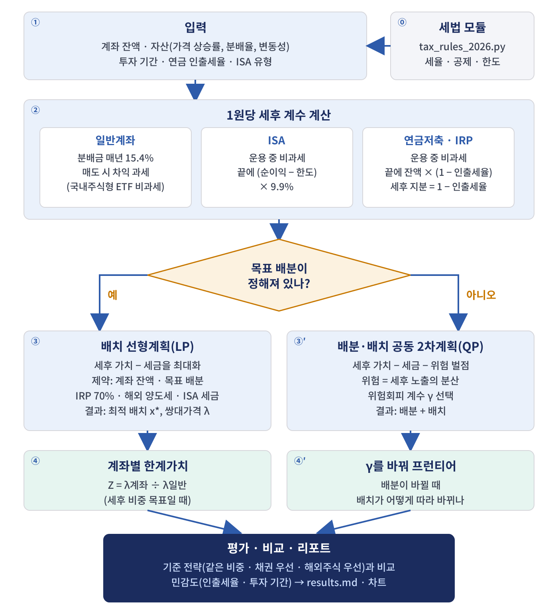

# Huang 모형과 한국형 자산배치

> 세후 기준으로 계좌를 고른다 — Huang(2008) 세금 차익거래(tax arbitrage)와 2026년 11월 한국 세제

## 0. 이 강의의 질문

같은 2억 원을 같은 비중(국내주식 30%, 해외주식 40%, 채권 30%)으로 투자해도, 어느 계좌에 무엇을 담느냐에 따라 10년 뒤 실제로 쓸 수 있는 돈이 달라진다. 이 강의는 세 가지를 다룬다.

1. Huang(2008)은 "어디에 둘지(자산배치, asset location)"와 "얼마나 둘지(자산배분, asset allocation)"를 어떻게 분리했는가
2. 한국의 상품별·계좌별 과세 구조에 그 원리를 옮기면 미국 교과서와 어떤 점이 달라지는가
3. 실무에서 쓰려면 모형을 어떻게 정교화해야 하는가

핵심 결론을 먼저 적는다.

- 한국에서는 "주식은 일반계좌(taxable brokerage account), 채권은 연금계좌(pension account)"라는 규칙이 그대로 맞지 않는다. **국내주식인지 해외주식인지**가 더 중요하다.
- 배치의 기준은 세율이 높은 자산이 아니라 **계좌를 옮겼을 때 세후 가치(after-tax value)가 가장 많이 늘어나는 자산**이다.
- 계좌별 환산계수(conversion factor) $Z$는 미리 정하는 숫자가 아니라, 세후 현금흐름 최적화의 결과로 **한계가치(marginal value)에서 도출**하는 지표다.

---

## 1. 기본 개념

### 1.1 자산배분과 자산배치

| 구분 | 자산배분(asset allocation) | 자산배치(asset location) |
|---|---|---|
| 질문 | 주식·채권에 각각 얼마를 둘 것인가 | 그 자산을 어느 계좌에 둘 것인가 |
| 결정 변수 | 자산별 비중 | 계좌×자산 조합 |
| 영향 | 위험과 기대수익 | 같은 위험에서의 세후 가치 |
| 대표 오류 | 위험 감내도와 맞지 않는 비중 | 세금 혜택이 작은 자산으로 절세계좌(tax-advantaged account)를 채움 |

자산배치는 위험을 바꾸지 않고 세금만 바꾸는 결정이다. 그래서 배치 효과를 평가할 때는 **전체 위험 노출(risk exposure)을 같게 맞춘 뒤** 비교해야 한다. 주식 비중을 높여 얻은 추가 수익을 절세 효과로 계산하면 안 된다.

### 1.2 과세계좌와 과세이연계좌

- **과세계좌(taxable account)**: 이자·배당·매매차익(capital gain)이 생길 때마다 과세된다. 한국의 일반 위탁계좌가 여기에 해당한다.
- **과세이연계좌(tax-deferred account, TDA)**: 운용 중에는 과세하지 않고 인출할 때 과세한다. 미국의 401(k)·IRA, 한국의 연금저축(pension savings account)·IRP(Individual Retirement Pension, 개인형 퇴직연금)가 대표적이다.
- **세후 가치**: 지금 계좌를 정리하거나 계획대로 인출했을 때 손에 남는 금액. 연금계좌 1억 원과 일반계좌 1억 원은 세후 가치가 다르므로 같은 1억 원으로 더하면 안 된다.

### 1.3 왜 과세이연(tax deferral)이 가치를 만드는가

일반계좌에서는 매년 낸 세금만큼 재투자 원금이 줄어든다. 과세이연계좌에서는 세금으로 나갈 돈까지 복리(compounding)로 굴러간다. 같은 세율이라도 **세금을 늦게 낼수록, 운용 기간이 길수록, 매년 과세되는 소득(이자·분배금, distribution)이 많을수록** 과세이연의 가치가 커진다. 반대로 원래 비과세인 소득을 과세이연계좌에 넣으면 인출세(withdrawal tax)만 새로 생겨 손해가 날 수 있다. 한국의 국내주식형 ETF가 이 경우다(5장).

### 1.4 은퇴계좌의 과세 구조 — 미국과 한국

Huang(2008)은 미국 제도를 배경으로 한 논문이다. 미국과 한국은 은퇴계좌에 세금을 매기는 방식이 다르므로, 두 나라를 먼저 구분해 둔다.

**은퇴계좌(retirement account)** 는 나라가 노후 대비용으로 세금 혜택을 주는 계좌다. 미국의 401(k)·IRA, 한국의 연금저축·IRP가 여기에 해당한다. 넣을 때 세금 혜택을 주고, 굴리는 동안 과세하지 않으며, 꺼낼 때 과세한다.

| 단계 | 미국 401(k)·IRA (일반형) | 한국 연금저축·IRP |
|---|---|---|
| 넣을 때 | 소득공제 — 세금 내기 전 소득으로 넣는 효과 | 세금 낸 소득으로 넣고, 13.2~16.5% 세액공제(tax credit)를 돌려받음 (연 900만 원까지) |
| 굴릴 때 | 비과세 | 비과세 (과세이연) |
| 꺼낼 때 | 인출액 전체에 그해 소득세율 (연방 10~37% 누진 + 주 소득세) | 연금소득세 5.5%(55~69세)·4.4%(70~79세)·3.3%(80세 이상, 종신형) |
| 일찍 꺼내면 | 59½세 전 인출 시 10% 추가 세금 | 연금 외 수령 시 기타소득세 16.5% |

**꺼낼 때 내는 세금은 미뤄 둔 세금이다.** 미국 일반형 계좌는 넣을 때 그 돈을 소득에서 빼 준다. 그래서 꺼낼 때는 원금과 수익을 구분하지 않고 인출액 전체를 그해 소득처럼 과세한다. 세율은 고정되어 있지 않고 그해 소득 수준에 따라 달라진다. 2장의 박 부장 예시에서 쓰는 30%는 "이 사람의 세율이 30%라면"이라는 가정이다. 은퇴계좌 1억 원 중 3,000만 원은 언젠가 낼 세금이고, 박 부장이 실제로 쓸 수 있는 몫은 7,000만 원이다.

한국은 이 몫이 훨씬 작다. 연금으로 받으면 3.3~5.5%만 내므로, 연금계좌 1억 원의 세후 몫은 9,450만 원(55~69세)·9,560만 원(70~79세)·9,670만 원(80세 이상)이다.

**넣을 때 세금 혜택을 받았는지가 꺼낼 때 과세를 정한다.** 그래서 같은 계좌 안에서도 돈의 출처(자금 원천)를 따로 기록한다.

| 넣은 돈의 성격 | 예 | 꺼낼 때 |
|---|---|---|
| 세금 혜택을 받고 넣은 돈 | 미국 일반형 납입, 한국 세액공제받은 납입 | 원금과 수익 모두 과세 |
| 세금을 이미 내고 넣은 돈 | 미국 비공제 납입·Roth, 한국 900만 원 초과 납입 | 원금은 비과세, 수익만 과세 (Roth는 요건을 갖추면 전부 비과세) |
| 아직 과세하지 않은 퇴직금 | 한국 이연퇴직소득 | 퇴직소득세의 70%(수령 10년 차까지), 이후 더 낮은 비율 |

한국 연금계좌가 유리한 이유가 여기서 나온다. 넣을 때 13.2~16.5%를 돌려받고, 연금으로 꺼낼 때 3.3~5.5%만 낸다. "넣을 때 깎아 준 만큼 나중에 비슷하게 다시 내는" 미국 예시와 구조가 다르다.

**IRP는 소득이 있으면 은퇴 후에도 넣을 수 있다.** IRP(Individual Retirement Pension, 개인형 퇴직연금)는 소득이 있는 모든 취업자(근로·사업소득)와 퇴직금 수령자가 가입할 수 있고, 나이 상한은 따로 없다. 55세 전에 퇴직하면 퇴직금은 IRP로 받는 것이 원칙이다. 세액공제는 연금저축과 합산해 연 900만 원까지이며, 공제율은 종합소득 4,500만 원(근로소득만 있으면 총급여 5,500만 원) 이하면 16.5%, 그 외 13.2%다. 세액공제는 낼 세금에서 빼 주는 것이라, 낼 소득세가 없으면 돌려받을 것도 없다. 퇴직금을 다 쓴 뒤라도 일해서 버는 소득이 있으면 그 소득으로 넣고 공제를 받을 수 있다. 일하는 은퇴자에게는 연금계좌 1원이 일반계좌 1원보다 가치가 크다($Z>1$).

**연금으로 인정받는 금액에는 해마다 한도가 있다.** 연금으로 받으려면 만 55세 이상이고 가입한 지 5년이 지나야 한다(퇴직금이 들어간 IRP는 5년 조건 면제). 해마다 연금으로 인정받는 금액은 소득세법 시행령 제40조의2의 다음 식으로 정해진다.

$$
연금수령한도=\frac{연금계좌\ 평가액}{11-연금수령연차}\times\frac{120}{100}
$$

연금수령연차는 55세와 가입 5년을 채운 해가 1년 차이고, 연금을 받지 않아도 자동으로 센다. 11년 차부터는 한도가 없다. 한도를 넘겨 꺼낸 금액은 연금 외 수령으로 보아 16.5%를 낸다. 또 세액공제받은 원금과 운용수익에서 받는 연금이 연 1,500만 원을 넘으면 종합과세와 16.5% 분리과세 중 하나를 고른다.

| 나이 | 상태 | 의미 |
|---|---|---|
| 68세 | 근로·사업소득으로 가입, 연 900만 원 납입 | 13.2~16.5% 세액공제 |
| 73세 | 55세 + 가입 5년 충족 → 1년 차 | 연금 수령 가능, 받지 않아도 연차는 셈 |
| 80세 | 8년 차 | 세율 3.3%, 연간 한도는 평가액의 40%(평가액 ÷ 3 × 1.2) |
| 83세 | 11년 차 | 연금수령한도 없음, 세율 3.3% 유지 |

실제 가입·인출 전에는 금융회사나 국세상담센터(126)에서 본인 계좌의 조건을 확인한다.


---

## 2. Huang(2008) 모형

### 2.1 설정

Jennifer Huang, "Taxable and Tax-Deferred Investing: A Tax-Arbitrage Approach", *Review of Financial Studies* 21(5), 2008, pp. 2173–2207.

- 투자자는 과세계좌와 과세이연(은퇴)계좌를 함께 가진다.
- 여러 기간에 걸쳐 소비·납입·자산배분·자산배치를 결정한다(intertemporal portfolio problem).
- 자산마다 세금 부담이 다르다(이자에 높은 세율, 주식 매매차익은 실현 시점까지 이연 등).

### 2.2 세금 차익거래(tax arbitrage) 논리 — 박 부장 이야기

Huang의 출발점은 "은퇴계좌에 무엇을 넣든, 과세계좌의 포트폴리오를 바꿔 전체 위험 노출을 원래대로 되돌릴 수 있다"는 관찰이다. 그렇다면 은퇴계좌의 역할은 위험을 바꾸는 것이 아니라 **세금 혜택을 만들어 내는 것**으로 좁혀진다. 이 논리를 한 투자자의 이야기로 따라가 본다. 숫자는 논문의 무대인 미국식 세율로 단순화한 예시다.

**먼저 '재조정'의 뜻을 숫자로 본다.** 위험은 계좌별 구성이 아니라 두 계좌를 합친 전체 보유량으로 정해진다. 세금은 잠시 빼고, 일반계좌 1억·연금계좌 1억으로 전체 주식 50 : 채권 50을 맞추는 두 방식을 비교한다.

| 방식 | 일반계좌 | 연금계좌 | 합계 |
|---|---|---|---|
| ① 계좌마다 반반 | 주식 5천 · 채권 5천 | 주식 5천 · 채권 5천 | 주식 1억 · 채권 1억 |
| ② Huang 방식 | 주식 1억 | 채권 1억 | 주식 1억 · 채권 1억 |

②에서는 연금계좌가 채권 쪽으로 기운 만큼 일반계좌를 주식 쪽으로 기울였다. 이것이 "일반계좌로 위험을 재조정한다"는 말의 뜻이다. 주가가 20% 떨어지면 두 방식 모두 주식 1억 원에서 2,000만 원을 잃는다. 시장은 주식이 어느 계좌에 있는지 모르므로 합계가 같으면 위험도 같다. 그런데 세금은 다르다. ①에서는 일반계좌 채권 5,000만 원의 이자 200만 원(4%)에 15.4%가 붙어 매년 약 31만 원을 내고, ②에서는 채권이 모두 연금에 있어 운용 중 세금이 0원이다.

이 재조정은 따로 하는 계산이 아니다. 절세계좌를 세금 순위대로 먼저 채우고 남는 것을 일반계좌에 두면 일반계좌 구성은 "전체 목표 − 절세계좌에 넣은 것"으로 저절로 정해진다(4.2절). 다만 정밀하게는 연금 1억 원 중 내 몫이 9,450만 원(인출세 5.5%)이므로 세후 기준으로 맞춘다. 세후 재산 1억 9,450만 원의 절반인 9,725만 원을 주식으로 두려면 일반계좌를 주식 9,725만 · 채권 275만으로 하면 된다.

아래 박 부장 이야기는 같은 논리를 Huang 논문의 무대인 미국식 세율로 따라간다.

| 항목 | 가정 (미국식 예시) |
|---|---|
| 계좌 | 과세계좌 1억 원, 은퇴계좌 1억 원 |
| 목표 | 세후 기준 주식 50 : 채권 50 |
| 채권 | 수익률 4%, 이자에 매년 40% 과세 |
| 주식 | 수익률 7%, 실효 세율 10% (팔 때까지 과세를 미루므로 낮다) |
| 은퇴계좌 | 운용 중 비과세, 꺼낼 때 30% 과세 |

**① 배치 — 세금이 많이 새는 채권부터 은퇴계좌에 넣는다.** 1억 원을 과세계좌에 1년 두면 채권은 이자 400만 원의 40%인 160만 원, 주식은 이익 700만 원의 10%인 70만 원을 세금으로 낸다. 은퇴계좌라는 '세금 방패'는 한정되어 있으므로 세금이 더 많이 새는 채권을 넣어야 90만 원을 더 아낀다. Huang의 표현으로는 실효 세금 보조가 가장 큰 자산을 은퇴계좌에 둔다.

**② 조정 — 은퇴계좌 1억 중 박 부장의 몫은 7,000만 원이다.** 꺼낼 때 낼 30%는 넣을 때 미뤄 둔 세금이다(1.4절). 수익도 위험도 박 부장은 70%만 진다. 세후 재산은 1억 + 7,000만 = 1억 7,000만 원이고, 세후 주식 목표는 그 절반인 8,500만 원이다. 은퇴계좌를 채권으로 채우면 세후 채권이 7,000만 원이므로, 과세계좌를 주식 8,500만·채권 1,500만으로 맞추면 세후 50:50이 된다. 표시 잔액으로는 주식이 42.5%지만 세후로는 정확히 50%다.

**③ 분리 — 위험 성향이 바뀌어도 배치는 그대로다.** 박 부장이 세후 주식 비중을 40%로 낮추면 세후 주식 목표는 6,800만 원이 된다. 은퇴계좌는 여전히 채권 1억 원이고, 과세계좌만 주식 6,800만·채권 3,200만으로 바뀐다. 어디에 둘지(배치)는 세금이, 얼마나 둘지(배분)는 위험 성향이 정한다.

**④ 환원 — 은퇴계좌는 '과세계좌 + 보조금'으로 바꿔 볼 수 있다.** 은퇴계좌 채권 1억 원의 1년 이익 400만 원은 세후 280만 원(×0.7)이다. 같은 세후 몫 7,000만 원을 과세계좌 채권에 두면 이자 280만 원에서 40%를 떼어 168만 원이 남는다. 차이 112만 원이 매년 받는 세금 보조다. 그래서 박 부장의 문제는 "세후 1억 7,000만 원 + 매년 보조금을 가진 과세계좌 하나"의 문제로 줄어든다.


**같은 이야기를 한국 세율로 바꾸면** 네 단계의 논리는 같지만 숫자가 달라진다. 한국은 이자 15.4%, 국내주식형 ETF 매매차익 비과세, 연금소득세 5.5%로 둔다.

| 단계 | 미국식 예시 | 한국 |
|---|---|---|
| ① 배치 | 채권(세금 160만) > 주식(70만) | 채권(61.6만) > 국내주식형 ETF(0) — 국내주식은 맨 뒤, 해외주식형 ETF와 채권이 경쟁 |
| ② 조정 | 은퇴계좌 1억 = 세후 7,000만 | 은퇴계좌 1억 = 세후 9,450만 |
| ③ 분리 | 성립 | 논리는 같지만 차입 불가·IRP 위험자산 70% 한도로 쉽게 깨진다 |
| ④ 보조 | 매년 112만 원 | 매년 58.2만 원 + 넣을 때 세액공제 |

한국 ④의 계산은 다음과 같다. 은퇴계좌 채권 1억 원의 이익 400만 원은 세후 378만 원(×0.945)이다. 같은 세후 몫 9,450만 원을 과세계좌 채권에 두면 이자 378만 원에 15.4%가 붙어 319.8만 원이 남는다. 차이는 58.2만 원이다. 해외주식형 ETF와 채권 중 무엇이 먼저인지는 5장 김 교수 사례에서 계산한다.

### 2.3 핵심 결과

1. **분리 가능성(separation)**: 일정 조건에서 최적 배치(어디에 둘지)는 최적 배분(얼마나 둘지)과 분리된다.
2. **배치 규칙**: 세금 부담이 큰 자산을 과세이연계좌에 두어 세금 혜택을 최대화하고, 과세계좌 포트폴리오로 원하는 위험 노출을 맞춘다. Huang의 학위논문 표현으로는, 과세이연계좌에는 **실효 세금 보조(effective tax subsidy)가 가장 큰 자산**만 담는다.
3. **문제의 환원**: 두 계좌 문제는 세금 보조(tax subsidy)만큼 부(富)를 조정한 **과세계좌 하나의 문제**로 바뀐다. 과세이연계좌는 전체 포트폴리오 결정에 부의 효과로만 영향을 준다.
4. **강건성**: 이 결과는 자본이득 과세이연, 소비·납입 결정, 확률적 세율을 넣어도 유지된다.

### 2.4 Huang 아이디어의 한국형 표현

계좌마다 1원의 경제적 가치가 다르다는 점을 환산계수 $Z$로 나타내면 다음과 같다.

$$
W_{eq}=W_{일반}+Z_{ISA}W_{ISA}+Z_{연금저축}W_{연금저축}+Z_{IRP}W_{IRP}
$$

$Z$는 각 계좌의 자산을 일반계좌와 같은 경제적 기준으로 바꾸는 계수다. 위 식은 원논문의 공식을 그대로 옮긴 것이 아니라, Huang의 "두 계좌 문제를 조정된 부의 과세계좌 문제로 환원한다"는 아이디어를 한국 계좌 구조에 맞춰 개념적으로 쓴 것이다.

### 2.5 Huang의 요령이 통하려면 — 네 가지 전제

Huang의 요령은 한 줄로 줄일 수 있다. **"은퇴계좌에 무엇을 넣든 과세계좌에서 위험을 되돌릴 수 있으니, 배치는 세금만 보고 정한다."** 이 요령이 맞으려면 아래 네 가지가 참이어야 한다. 하나라도 깨지면 "세금 많은 자산부터 은퇴계좌에"라는 단순 규칙이 흔들린다.

| 쉬운 질문 | 아니면 생기는 일 | 미국 | 한국 |
|---|---|---|---|
| ① 과세계좌에서 위험을 마음대로 되돌릴 수 있나? | 배치가 위험 성향에 따라 달라진다 | 과세계좌는 신용거래 가능 (비용·한도 있음) | 연금계좌 차입 불가, IRP 위험자산 70% |
| ② 과세계좌에 세금 없는 대안이 없나? | 세금 순위가 바뀐다 | 비과세 지방채 | 국내주식형 ETF 매매차익 비과세 |
| ③ 이익과 손실을 똑같이 과세하나? | 과세계좌 주식의 이점이 줄어든다 | 손실은 다른 소득과 연 3,000달러까지만 상계 | 국내주식 손실 공제 없음, 해외주식은 같은 해만 통산 |
| ④ 은퇴계좌 돈을 필요할 때 꺼낼 수 있나? | 비상금 채권을 과세계좌에 둔다 | 59½세 전 10% 추가 세금 | 연금 외 수령 16.5%, IRP 인출 사유 제한 |

**전제 ① 되돌리기 — 차입·공매도 제약(borrowing and short-sale constraints).** 박 부장이 세후 주식 70%를 원한다고 하자. 세후 재산 1억 7,000만 원의 70%인 1억 1,900만 원이 필요하다. 그런데 과세계좌를 주식으로 다 채워도 1억 원이고, 돈을 빌리거나 채권을 공매도할 수 없다. 모자란 1,900만 원은 은퇴계좌에 주식으로 담아야 하고, 세후 1,900만 원이 되려면 세전으로 2,714만 원(÷0.7)이 필요하다. 주식 50%였다면 은퇴계좌는 전부 채권이었으므로, 이제는 위험 성향이 배치를 바꾼다. 배치와 배분의 분리가 깨진 것이다. Huang의 학위논문은 제약이 강하면 "채권 우선" 규칙 자체가 깨지는 경우도 있음을 보였다. 한국 연금계좌는 차입이 안 되고 IRP는 위험자산 70% 한도가 있어 이 전제가 더 자주 깨진다.

**전제 ② 세금 순위 — 비과세 채권.** 미국에는 이자가 비과세인 대신 금리가 낮은 지방채(municipal bond)가 있다. 회사채 4%에 이자 40%가 과세되면 세후 2.4%인데, 지방채 3%는 세후에도 3.0%다. 과세계좌에서 채권을 지방채로 들면 채권의 세금 누수가 0이 되므로, 은퇴계좌 자리는 세금이 많이 나오는 액티브 주식펀드에 쓰는 편이 낫다. Shoven·Sialm(2004)은 주식 포트폴리오가 충분히 세금 비효율적이면 주식이 은퇴계좌로, 지방채가 과세계좌로 가야 함을 보였다. 세금 효율이 높은 패시브 펀드는 과세계좌, 낮은 액티브 펀드는 은퇴계좌다. 한국에서는 매매차익이 비과세인 국내주식형 ETF가 '과세계좌의 비과세 자산' 역할을 한다. 그래서 김 교수 사례에서 국내주식은 일반계좌에 남고, 절세계좌는 해외주식형 ETF와 채권이 차지한다.

**전제 ③ 손실 공제 — 이익과 손실의 비대칭.** 과세계좌 주식에는 숨은 혜택이 있다. 주가가 떨어지면 손실을 실현해 다른 이익의 세금을 줄일 수 있다(tax-loss harvesting). 박 부장의 과세계좌 주식 1억 원이 20% 떨어져 2,000만 원 손실이 났다고 하자. 손실을 다른 소득과 모두 상계할 수 있으면 세율 40%에서 800만 원을 아낀다. 그런데 미국은 자본이익이 없으면 다른 소득과는 연 3,000달러(약 400만 원)까지만 상계하고 나머지는 이월하므로, 그해 절세는 약 160만 원에 그친다. Fischer·Gallmeyer(2017)는 이익과 손실을 다르게 과세하면 세금 효율이 아주 높은 주식펀드만 과세계좌에 두는 것이 최적이고, 세금 효율이 평균인 펀드는 은퇴계좌에 우선 둔다는 결과를 보였다. 한국은 국내주식형 ETF 손실이 공제되지 않고, 해외주식 손실은 같은 해 해외주식 이익과만 통산하며 이월되지 않는다.

**전제 ④ 유동성 — 자산배치 퍼즐(asset location puzzle).** 이론은 채권을 은퇴계좌에 두라고 하지만, Bergstresser·Poterba는 주식은 은퇴계좌에, 과세 채권은 과세계좌에 두는 가계가 많다는 사실을 보고했다. Amromin(2008)은 보험으로 막을 수 없는 소득 위험과 은퇴계좌 자금에 접근하기 어려운 점이 겹쳐, 일부 가계가 세금 효율 대신 소득이 나쁠 때 쓸 수 있는 유동성을 택한다고 설명했다(예비적 선택). 박 부장이 실직에 대비해 3,000만 원을 비상금으로 두려 한다고 하자. 미국에서 은퇴계좌에서 일찍 꺼내면 소득세 30%와 추가 세금 10%로 1,200만 원을 낸다. 한국에서 연금 외로 꺼내면 16.5%로 495만 원이다. 과세계좌에 채권으로 두면 연간 세금은 미국식으로 48만 원(3,000만 × 4% × 40%)에 그친다. 그래서 비상금 채권은 세금이 새더라도 과세계좌에 둔다. 한국에서 IRP는 중도 인출 사유까지 제한되므로 비상금은 일반계좌에 남기는 것이 자연스럽다.


---

## 3. 한국 제도 지도 (2026년 11월 기준)

### 3.1 상품별 과세 — 일반계좌 기준

| 투자상품 | 매매차익 과세 | 배치에 주는 의미 |
|---|---|---|
| 국내주식형 ETF | 비과세 (분배금은 15.4%) | 매매차익만 보면 절세계좌에 넣을 추가 혜택이 작다 |
| 국내상장 해외주식형 ETF | 실제 매매차익과 과표기준가(taxable base price) 상승분 중 작은 금액에 배당소득세(dividend income tax) 15.4% (보유기간 과세, holding-period taxation) | ISA(Individual Savings Account, 개인종합자산관리계좌)·연금계좌 배치를 우선 검토 |
| 국내상장 채권 ETF | 위와 같은 보유기간 과세, 분배금 15.4% | ISA·연금계좌 배치를 우선 검토 |
| 해외상장 주식·ETF | 연간 양도손익 통산, 기본공제(basic deduction) 250만 원 후 22% 분리과세(separate taxation) | 일반계좌에서 공제·손익통산(netting of gains and losses)·실현 시점 관리 |

두 가지를 덧붙인다.

- 국내주식형 ETF도 **분배금은 과세**된다. "모든 수익이 비과세"는 아니다.
- 국내상장 ETF의 매매차익과 분배금은 배당소득이므로 다른 이자·배당과 합쳐 연 2,000만 원을 넘으면 **금융소득종합과세(comprehensive taxation of financial income)**(최고 49.5%) 대상이 된다. 해외상장 ETF의 양도소득은 분리과세라 여기에 들어가지 않는다. 금융소득이 큰 투자자일수록 국내상장 해외주식형 ETF를 일반계좌에 두는 비용이 커지므로 절세계좌 배치의 이유가 강해진다.

### 3.2 계좌의 세 가지 역할

| 계좌 | 주요 세제 | Huang 관점의 역할 |
|---|---|---|
| 일반계좌 | 상품별로 과세가 다름 | 원래 세금 부담이 낮은 자산, 유동성 자금 |
| ISA | 계좌 내 손익통산, 일반형 200만 원·서민형/농어민형 400만 원 비과세, 초과분 9.9% 분리과세 | 중기 자금의 과세 부담 완화 |
| 연금저축·IRP | 운용 중 과세이연, 요건을 갖춰 연금으로 받으면 연금소득세(pension income tax) | 장기 운용과 인출 계획의 결합 |

- ISA 비과세 한도는 매년 새로 생기는 한도가 아니라 **계좌를 정산할 때 적용되는 한도**다.
- 연금저축·IRP 세액공제(tax credit) 한도는 합산 연 900만 원, 그중 연금저축은 최대 600만 원이다. 공제율은 소득 조건에 따라 13.2% 또는 16.5%다.
- IRP는 위험자산을 적립금의 70%까지만 담을 수 있다. 연금저축펀드에는 같은 일률 한도가 없다. 채권형 ETF는 대체로 안전자산으로 분류되지만 상품별 분류는 금융회사에서 확인해야 한다.

### 3.3 연금 인출 과세 — 자금 원천(source of funds)에 따라 다르다

| 자금 원천 | 연금으로 받을 때 | 중도 인출·해지 |
|---|---|---|
| 세액공제받은 납입원금 + 운용수익 | 연금소득세 5.5%(55~69세)·4.4%(70~79세)·3.3%(80세 이상), 종신형(life annuity)은 3.3% | 기타소득세(other income tax) 16.5% |
| 세액공제받지 않은 납입원금 | 과세하지 않음 | 과세하지 않음 |
| 이연퇴직소득(퇴직금) | 퇴직소득세의 70%(수령 10년 차까지), 이후 더 낮은 비율 | 퇴직소득세 |

사적연금 수령액(과세 대상분)이 연 1,500만 원을 넘으면 종합과세와 16.5% 분리과세 중에서 고른다. 따라서 연금계좌 전체에 "인출세율 5.5%"를 일률적으로 곱하는 방식은 부정확하다. 이 점이 6장 정교화의 출발점이다.

---

## 4. 한국형 응용 원리

### 4.1 주식이라서 일반계좌가 아니다

미국 교과서의 기본형은 "세금이 무거운 채권은 과세이연계좌, 세금이 가벼운 주식은 과세계좌"다. 한국에서는 주식 안에서 과세가 갈린다.

| 자산 | 우선 검토할 위치 | 이유 |
|---|---|---|
| 저분배 국내주식형 ETF | 일반계좌 | 매매차익이 이미 비과세 |
| 국내상장 해외주식형 ETF | ISA·연금 | 일반계좌에서 생길 매매차익 과세를 줄이거나 이연 |
| 채권 ETF | ISA·연금 | 매매차익·분배금 과세 부담 완화 |

해외주식 ETF와 채권 ETF 중 무엇을 절세계좌에 먼저 넣을지는 기대수익률, 분배율, 회전율, 투자 기간, 인출세금을 비교해 정한다. 같은 미국 주가지수 노출이라도 국내상장 상품을 절세계좌에 넣는 안과 미국상장 상품을 일반계좌에 두는 안(250만 원 공제·22% 분리과세)을 함께 비교해야 한다.

### 4.2 배치 예시 — 총자산 2억 원

계좌 잔액은 일반계좌 1억 원, ISA 4,000만 원, 연금저축 3,000만 원, IRP 3,000만 원이다. 목표는 국내주식 6,000만 원, 해외주식 8,000만 원, 채권 6,000만 원이다.

| 계좌 | 국내주식형 ETF | 국내상장 해외주식형 ETF | 채권 ETF |
|---|---:|---:|---:|
| 일반계좌 | 6,000만 원 | — | 4,000만 원 |
| ISA | — | 4,000만 원 | — |
| 연금저축 | — | 3,000만 원 | — |
| IRP | — | 1,000만 원 | 2,000만 원 |
| 합계 | 6,000만 원 | 8,000만 원 | 6,000만 원 |

이 표는 해외주식 성장분의 과세이연을 우선 활용한다는 가정으로 만든 출발점이다. IRP는 위험자산 70% 한도 때문에 채권을 2,000만 원 담았다. 표시 잔액 기준 배분이므로, Huang 방식으로 완성하려면 인출세금을 반영한 가치와 위험 노출을 다시 계산해야 한다(5.6절).

**실무 순서는 두 단계다.** 먼저 전체 배분(예: 국내 6,000 · 해외 8,000 · 채권 6,000)을 정하고, 절세계좌를 세금 순위대로 채운 뒤 남는 것을 일반계좌에 둔다. 대부분은 이것으로 끝난다. 추가 계산이 필요한 경우는 네 가지뿐이다.

| 추가 계산이 필요한 경우 | 왜, 어떻게 |
|---|---|
| 배분을 세후 기준으로 정밀하게 맞출 때 | 연금 1억의 내 몫은 9,450만 원이다. 한국은 인출세가 낮아 차이가 작다(김 교수 사례에서 채권 55만 원 이동). |
| 일반계좌가 작거나 IRP 70% 한도에 걸릴 때 | 채워 넣기만으로는 목표를 맞출 수 없다. 배분과 배치를 함께 푸는 모델(8.5절)이 필요하다. |
| 시간이 지나 비중이 흐트러졌을 때 | 리밸런싱은 연금계좌 안에서 한다. 연금 안의 매매는 세금이 없지만 일반계좌에서 국내상장 해외주식형 ETF를 팔면 15.4%가 붙는다. |
| 해마다 새 돈을 넣을 때 | 세액공제(연 900만 원)와 ISA 한도를 따져 넣을 계좌를 정한다(4.3절). |

### 4.3 새로 납입하는 돈은 따로 본다

이미 있는 돈을 배치하는 문제와 새 돈을 어디에 납입할지는 다른 문제다. 새 납입액의 경제성은 다음 네 항목을 함께 본다.

$$
경제적\ 혜택=납입\ 시\ 세액공제+운용\ 중\ 절세\ 효과-인출\ 시\ 세금-유동성\ 제약의\ 비용
$$

세액공제 환급액을 재투자한다면 그 자금도 비교에 넣는다. 가까운 시기에 쓸 돈이라면 연금에 묶이는 제약이 더 중요하다.

### 4.4 손실 실현(tax-loss harvesting) — 미국과 한국

손실 수확(tax-loss harvesting)은 떨어진 종목을 팔아 손실을 확정하고, 그 손실로 다른 이익의 세금을 줄이는 방법이다. 손실을 세금에서 인정하는 범위가 미국과 한국은 크게 다르다.

| | 미국 | 한국 (일반계좌) |
|---|---|---|
| 이익과 상계 | 자본이익과 전액 상계 | 해외상장 주식은 같은 해 해외주식 이익과만 통산 |
| 다른 소득과 상계 | 연 3,000달러까지 (부부 별도 신고 1,500달러) | 불가 |
| 다음 해 이월 | 기한 없이 이월 | 불가 |
| 재매수 제한 | 앞뒤 30일 안에 같은 증권을 다시 사면 손실 불인정 (워시세일, wash sale) | 미국식 규정 없음 |
| 손실 효과가 없는 상품 | — | 국내 상장주식(소액주주)·국내주식형 ETF(이익도 비과세), 국내상장 ETF끼리는 손익 통산 불가 |

미국에서는 손실을 팔아 확정하고 비슷하지만 같지 않은 펀드로 갈아타 시장 노출을 유지하는 방식이 흔하다. 한국에서 쓸 수 있는 방법은 네 가지다.

1. **연말 손익통산(해외상장 주식):** 이익이 난 해에 손실 종목을 팔고 바로 다시 산다. 예를 들어 A 종목 이익이 1,000만 원이고 B 종목 평가손실이 600만 원이라고 하자. B를 팔지 않으면 $(1{,}000-250)\times22\%=165$만 원을 내고, B를 팔면 $(400-250)\times22\%=33$만 원을 내므로 132만 원을 줄인다.
2. **250만 원 공제 채우기:** 이익이 적은 해에는 이익 종목을 250만 원 범위에서 일부러 팔았다 다시 사서 취득가를 높인다. 나중에 낼 세금이 줄어든다.
3. **국내상장 해외 ETF는 ISA에:** 일반계좌에서는 ETF끼리 손익이 통산되지 않지만 ISA 안에서는 통산된다.
4. **날짜:** 세금은 결제일이 속한 연도로 따진다. 미국 주식은 결제 기간 때문에 12월 30일 무렵(한국 시간)이 그해의 마지막 매도 기회다.

이 차이는 2.5절 전제 ③과 연결된다. 미국은 손실 공제가 넓어 과세계좌에 주식을 둘 숨은 혜택이 있지만, 한국은 그 혜택이 훨씬 작다. 국내 상장주식은 종목당 50억 원 이상 등 대주주 요건에 해당할 때만 양도세가 과세된다.

---

## 5. 사례 — 김 교수의 10년 계획

> 김 교수는 은퇴까지 10년을 남겨 두고 있다. 투자금은 2억 원이다. "국내주식 30%, 해외주식 40%, 채권 30%로 하겠습니다. 그런데 어느 계좌에 담느냐에 따라 실제로 쓸 수 있는 돈이 얼마나 달라질까요?"

아래 세율과 수익률은 모형의 작동 원리를 보여 주기 위한 가정이다. 실제 세액은 개인 소득, 상품별 과표기준가, 연금 수령 조건을 반영해 계산해야 한다.

### 5.1 설정

계좌는 일반계좌 1억 원과 연금저축 1억 원 두 개만 쓴다. 연금저축의 1억 원은 세액공제받은 원금과 운용수익으로 구성되어 있다고 본다. 과거 세액공제는 두 배치안에 공통이므로 비교에서 뺀다.

| 자산 | 비중 | 투자금 | 연 수익률 가정 |
|---|---:|---:|---:|
| 국내주식형 ETF | 30% | 6,000만 원 | 6% |
| 국내상장 해외주식형 ETF | 40% | 8,000만 원 | 7% |
| 채권 ETF | 30% | 6,000만 원 | 4% |

| 자산·계좌 | 세금 계산 가정 |
|---|---|
| 일반계좌 국내주식형 ETF | 수익 전부 가격 상승, 매매차익 비과세 |
| 일반계좌 해외주식형 ETF | 분배 없이 성장, 10년 뒤 이익 전액에 15.4% |
| 일반계좌 채권 ETF | 연 4% 전부 분배, 매년 15.4% 과세 후 재투자 |
| 연금저축 | 운용 중 과세 없음, 10년 뒤 잔액에 평가상 인출세율(assumed withdrawal tax rate) 5.5% 차감 |

5.5%는 세후 가치 비교를 위한 평가 가정이다. 10년 뒤 한 번에 전액을 인출해도 이 세율이 적용된다는 뜻이 아니다. 수수료·외국세금·종합과세·수령 기간 중 추가 수익은 뺀다.

### 5.2 배치 A — "채권부터 연금에"

교과서 원칙을 따른 배치다.

| 자산 | 일반계좌 | 연금저축 |
|---|---:|---:|
| 국내주식 ETF | 6,000만 원 | — |
| 해외주식 ETF | 4,000만 원 | 4,000만 원 |
| 채권 ETF | — | 6,000만 원 |

10년 뒤 세후 가치(단위: 만 원)는 다음과 같다.

$$
6{,}000\times1.06^{10}=10{,}745
$$

$$
4{,}000+(4{,}000\times1.07^{10}-4{,}000)(1-0.154)=7{,}273
$$

$$
4{,}000\times1.07^{10}\times0.945=7{,}436
$$

$$
6{,}000\times1.04^{10}\times0.945=8{,}393
$$

합계는 약 3억 3,847만 원이다.

### 5.3 배치 B — "해외주식부터 연금에"

자산배분은 그대로 두고 해외주식 4,000만 원과 채권 4,000만 원의 계좌만 맞바꾼다.

| 자산 | 일반계좌 | 연금저축 |
|---|---:|---:|
| 국내주식 ETF | 6,000만 원 | — |
| 해외주식 ETF | — | 8,000만 원 |
| 채권 ETF | 4,000만 원 | 2,000만 원 |

일반계좌 채권의 연간 세후 재투자 수익률은 $4\%(1-0.154)=3.384\%$다.

| 위치·자산 | 계산 | 10년 뒤 세후 가치 |
|---|---|---:|
| 일반 국내주식 | $6{,}000(1.06)^{10}$ | 10,745만 원 |
| 일반 채권 | $4{,}000(1.03384)^{10}$ | 5,580만 원 |
| 연금 해외주식 | $8{,}000(1.07)^{10}(0.945)$ | 14,872만 원 |
| 연금 채권 | $2{,}000(1.04)^{10}(0.945)$ | 2,798만 원 |
| 합계 | | 약 3억 3,995만 원 |

투자금과 자산별 투자금은 같지만 배치 B가 **약 148만 원** 더 남는다(반올림 전 147만 원). 가정한 수익 경로에서의 비교이며, 연금 인출세 때문에 두 안의 세후 위험 노출까지 같다는 뜻은 아니다.

### 5.4 왜 해외주식이 먼저인가 — 1,000만 원 증분(incremental) 비교

| 자산 | 일반계좌 10년 뒤 | 연금 10년 뒤(세후) | 연금 배치의 차이 |
|---|---:|---:|---:|
| 국내주식 ETF | 1,791만 원 | 1,692만 원 | −98만 원 |
| 해외주식 ETF | 1,818만 원 | 1,859만 원 | +41만 원 |
| 채권 ETF | 1,395만 원 | 1,399만 원 | +4만 원 |

이 가정에서 연금의 한정된 공간을 쓸 우선순위는 다음과 같다.

$$
해외주식\ ETF\;>\;채권\ ETF\;>\;국내주식\ ETF
$$

해외주식 1,000만 원을 연금으로 옮기면 약 41만 원이 늘고, 대신 채권 1,000만 원을 일반계좌로 내보내면 약 4만 원을 잃는다. 순효과는 약 37만 원이고, 이를 네 번 하므로 $4\times37만\ 원\approx148만\ 원$이다.

세율이 가장 높은 자산이 아니라 **계좌를 바꿨을 때 세후 가치가 가장 많이 늘어나는 자산**을 먼저 배치한 결과다. 국내주식 ETF가 음수인 이유도 같다. 일반계좌에서는 비과세인 수익이 연금 안에서는 인출세 대상이 된다.

### 5.5 인출세금 가정이 바뀌면 결론도 바뀐다

> "연금에서 꺼낼 때 세금을 더 내게 되면요?"

| 평가상 연금 인출세율 | 배치 B의 상대적 결과 |
|---|---|
| 5.5% | 약 148만 원 유리 |
| 약 13.1% | 두 배치안이 거의 같음 |
| 16.5% | 약 67만 원 불리 |

같은 모형으로 투자 기간을 바꿔 보면, 5.5%에서 배치 B의 우위는 5년이면 약 65만 원, 20년이면 약 417만 원으로 커진다. 대신 손익분기(break-even) 세율은 5년 약 14.2%, 10년 약 13.1%, 20년 약 11.7%로 내려간다. 기간이 길수록 과세이연 효과도, 인출세의 무게도 함께 커지기 때문이다.

이 세율들은 민감도 분석(sensitivity analysis)용이며 특정 수령 방식의 실제 세율을 단정한 것이 아니다. "해외주식을 항상 연금에 먼저 넣는다"는 규칙으로 일반화할 수 없다.

### 5.6 같은 1억 원도 위험을 부담하는 금액이 다르다

김 교수가 배치 B를 골랐다고 하자. 표시 잔액상 주식 비중은 다음과 같다.

$$
\frac{6{,}000+8{,}000}{20{,}000}=70\%
$$

연금의 세후 몫을 94.5%로 평가하면 세후 평가액은 일반 국내주식 6,000만 원, 일반 채권 4,000만 원, 연금 해외주식 7,560만 원, 연금 채권 1,890만 원, 합계 1억 9,450만 원이다. 세후 기준 주식 비중은

$$
\frac{6{,}000+7{,}560}{19{,}450}\approx69.72\%
$$

이다. 세후 기준 주식 70%가 목표라면 일반계좌에서 채권 약 55만 원을 팔아 국내주식을 사면 된다.

$$
0.70\times19{,}450-13{,}560=55
$$

여기서 쓴 0.945는 단순한 세후 소유지분 계수다. 과세이연의 미래 가치까지 반영한 Huang의 완전한 $Z$는 아니다. 국내·해외주식 비중까지 각각 맞추려면 함께 재조정(rebalancing)해야 한다.

### 5.7 모형이 김 교수에게 주는 답

| 김 교수의 질문 | 모형의 답 |
|---|---|
| 어디에 담을까? | 자산별 계좌 이동의 세후 증분가치를 비교 |
| 전체 주식 비중은 맞는가? | 인출 과세까지 반영한 위험 노출 재계산 |
| 연금 인출이 많아지면? | 인출세금 시나리오별로 배치 재평가 |
| 중간에 생활비가 필요하면? | 일반계좌의 최소 유동성 확보 |
| 시장이 크게 변하면? | 현재 원가·평가손익(unrealized gain or loss)을 반영해 다음 거래만 다시 결정 |

가장 중요한 것은 148만 원이라는 숫자보다 그 숫자를 만든 비교 방식이다. **"1,000만 원을 이 계좌에 넣으면 얼마가 늘고, 그 대신 다른 자산을 밖으로 옮기면 얼마를 잃는가?"** 이 기회비용(opportunity cost)을 모든 자산과 계좌에 대해 계산하는 것이 한국형 Huang 응용의 출발점이다.

---

## 6. 모형의 정교화

한국형으로 정교화하려면 단일 환산계수 $Z$를 먼저 구하지 말고, **계좌별 세후 현금흐름과 투자 제약을 직접 계산하는 동적 최적화(dynamic optimization)**로 확장한다. 자산배분·계좌배치·매매·납입·인출을 함께 결정하고, $Z$는 그 결과에서 계좌 자금의 한계가치를 비교하는 지표로 도출한다. 아래는 Huang의 원리를 확장한 응용 모형이며 원논문의 공식과 구분해야 한다.

### 6.1 목적함수(objective function) — 최종 잔액이 아니라 세후 소비(after-tax consumption) 가능액

$$
\max_{\pi}\;E\left[\sum_{t=0}^{T-1}\beta^{t}u(C_t)+\beta^{T}u(B_T^{net})\right]
$$

| 기호 | 의미 |
|---|---|
| $\pi$ | 납입·매매·계좌배치·인출 정책 전체 |
| $C_t$ | 해당 시점에 실제로 쓰는 세후 소비액 |
| $B_T^{net}$ | 마지막 시점에 인출·처분세금을 반영한 순자산 |
| $\beta$ | 미래 소비의 할인계수(discount factor) |
| $u$ | 위험회피(risk aversion)를 반영한 효용함수(utility function) |

은퇴 전이고 중간 소비를 분석하지 않는다면 $\max_{\pi}E[u(B_T^{net})]$로 줄인다. 연금 잔액을 세전으로, 일반계좌를 세후로 평가하는 오류를 목적함수 단계에서 막는다.

### 6.2 상태변수(state variable) — 계좌×자산에 취득원가와 자금 원천까지

계좌는 $a\in\{일반,ISA,연금저축,IRP\}$로 구분하고, 자산은 경제적 위험과 과세 방식을 함께 구분한다(국내주식형 ETF, 국내상장 해외주식형 ETF, 해외상장 ETF, 채권 ETF, 직접 채권, 현금·예금).

$$
S_t=(H_t,\ K_t,\ Q_t,\ L_t,\ D_t,\ Y_t,\ A_t)
$$

| 상태 | 기록 내용 |
|---|---|
| $H_t$ | 계좌별·상품별 보유량과 현금 |
| $K_t$ | 취득원가, 취득 시점 등 세금 계산용 장부 |
| $Q_t$ | ETF 과표기준가 관련 정보 |
| $L_t$ | 연간 실현손익(realized gain or loss), ISA 누적 손익 |
| $D_t$ | 남은 납입·세액공제 한도, 계좌 개설일 |
| $Y_t$ | 근로·사업·금융·연금소득 등 외부 소득 |
| $A_t$ | 나이와 연금 수령 관련 상태 |

연금계좌는 세액공제받은 원금, 공제받지 않은 원금, 운용수익, 이연퇴직소득을 따로 기록한다. 잔액만 저장해서는 한국의 인출세를 정확히 계산할 수 없다.

### 6.3 수익률을 가격 상승과 분배금으로 나눈다

$$
R_{i,t}^{total}=R_{i,t}^{price}+D_{i,t}
$$

같은 총수익률 7%라도 가격 상승 7%와 분배금 7%는 세후 결과가 다르다. 평가손익, 배당·이자·분배금, 매도 시 실현손익, 해외 원천징수(withholding tax) 같은 상품 내부의 세금 누수, 계좌 단계 세금을 따로 처리한다. 절세계좌라고 해서 해외 원천세까지 사라진다고 가정하면 안 된다.

### 6.4 세금은 세율 하나가 아니라 세금 계산 함수

$$
Tax_t=T_t(S_t,\ 매매_t,\ 분배금_t,\ 인출_t)
$$

| 세금 모듈 | 필요한 계산 |
|---|---|
| 일반계좌 | 금융소득 원천징수와 연간 최종세액(final tax liability)의 차이 |
| 해외주식 양도 | 연간 손익통산, 기본공제, 원화 환산 |
| 국내상장 ETF | 실제 매매차익과 과표기준가 변화 |
| ISA | 통산 가능한 손익, 비과세 한도, 해지·만기 정산 |
| 연금 | 자금 원천, 수령 요건·한도·방식별 과세 |
| 신규 납입 | 실제 적용 가능한 세액공제와 환급 시점 |

원천징수는 현금흐름이고 최종세액은 연간 소득을 합산해 정해질 수 있으므로 둘을 구분한다. 세법은 연도별 모듈로 분리해, 세법이 바뀌면 세금 계산 부분만 교체한다.

### 6.5 행동과 회계식(accounting identity)

$$
u_t=(b_{a,i,t},\ s_{a,i,t},\ c_{a,t},\ w_{a,t})
$$

$b$는 매수, $s$는 매도, $c$는 계좌별 신규 납입, $w$는 계좌별 인출이다(원 모형에서 $u$는 효용함수와 행동 벡터에 함께 쓰였으므로 문맥으로 구분한다). 계좌 내 현금은 다음 회계식으로 연결한다.

$$
\begin{aligned}
Cash_{a,t}^{end}=\;&Cash_{a,t}^{start}+납입+매도대금+분배금\\
&-매수대금-인출-세금-거래비용
\end{aligned}
$$

계좌 간 자금 이동은 자유로운 내부 이체로 보지 않고, 납입과 인출에 각각 제약을 건다.

### 6.6 한국의 투자 제약

| 제약 | 구현 방식 |
|---|---|
| 차입·공매도 제한 | 계좌별 현금과 보유량의 하한 |
| 계좌별 투자 가능 상품 | 허용되지 않는 조합의 보유량을 0으로 |
| IRP 위험자산 한도 | 규제상 분류에 따라 70% 비중 제한 |
| 납입 한도 | 연도별·계좌별 납입 가능액 |
| 연금·ISA 인출 조건 | 인출 가능 여부와 세금·불이익 |
| 생활비 필요 | 일반계좌 등의 최소 유동성 |

규제상 위험자산 분류와 경제적 위험은 분리한다. IRP에서 투자 가능하다는 사실이 시장위험이 낮다는 뜻은 아니다. 규제 한도는 따로 지키고, 포트폴리오 위험은 변동성·상관관계·손실 시나리오로 계산한다.

### 6.7 위험은 상품명이 아니라 위험요인(risk factor) 노출로 관리한다

$$
E_{k,t}=\sum_{a,i}B_{k,i}V_{a,i,t}
$$

$V_{a,i,t}$는 계좌별 상품 평가액, $B_{k,i}$는 상품 $i$의 위험요인 $k$ 노출, $E_{k,t}$는 전체 포트폴리오의 위험요인 노출이다. 위험요인은 한국 주식, 글로벌 주식, 금리·듀레이션, 신용, 환율 등이다. 국내상장 미국주식 ETF와 미국상장 ETF는 다른 상품이지만 상당 부분 같은 위험을 가진다. 이렇게 하면 세금 때문에 상품과 계좌를 바꿔도 원하는 경제적 노출을 유지하도록 최적화할 수 있다.

### 6.8 $Z$는 한계가치에서 도출한다

동적 최적화의 가치함수(value function)를 벨만 방정식(Bellman equation)으로 쓰면 다음과 같다.

$$
V_t(S_t)=\max_{u_t}\left\{u(C_t)+\beta E_t[V_{t+1}(S_{t+1})]\right\}
$$

계좌 $a$에 1원을 더했을 때 가치가 얼마나 늘어나는지 계산한다.

$$
\lambda_{a,t}=\frac{\partial V_t}{\partial Cash_{a,t}}
$$

일반계좌 대비 계좌 $a$의 한계 환산계수는 다음과 같다.

$$
Z_{a,t}^{marginal}=\frac{\lambda_{a,t}}{\lambda_{일반,t}}
$$

예컨대 $Z_{ISA,t}^{marginal}=1.08$이면, 그 상태와 가정에서 ISA 안의 1원이 일반계좌의 약 1.08원과 같은 한계가치를 가진다는 뜻이다. 세금과 제약이 비선형이므로 일반적으로 다음 등식은 성립하지 않는다.

$$
계좌\ 전체\ 가치\;\neq\;Z_{a,t}^{marginal}\times 전체\ 잔액
$$

외부에서 1원을 새로 납입하는 문제라면 납입 가능 여부와 세액공제를 따로 반영한다.

### 6.9 구현 — 계획을 매 기간 다시 세운다

모든 미래 상태를 동적계획법으로 정확히 풀면 계산량이 크다. 실무에서는 다음 절차가 현실적이다.

1. 현재 계좌·원가·세금 상태를 입력한다.
2. 수익률·분배금·환율·소득의 미래 시나리오를 만든다.
3. 시나리오별 세후 소비 가능액을 계산한다.
4. 제약을 지키며 납입·배치·매매·인출 계획을 최적화한다.
5. 이번 기간의 행동만 실행하고 다음 기간에 다시 계산한다.

연간 세금 정산과 월별 거래를 함께 반영하는 다기간 확률적 최적화(multistage stochastic optimization)로 시작할 수 있다. 미래 시장 경로를 미리 아는 것처럼 매매하지 않도록 시나리오 간 정보 제약(비예견성, non-anticipativity)을 건다.

### 6.10 검증 — 네 가지 기준 전략과 비교

| 비교 전략 | 확인할 효과 |
|---|---|
| 계좌마다 동일한 자산배분 | 배치 최적화의 기본 효과 |
| 채권부터 연금에 배치 | 단순 규칙보다 개선되는지 |
| 해외주식 ETF부터 절세계좌에 배치 | 성장자산 우선 배치와 비교 |
| 배분·배치·실현·인출 공동 최적화 | 전체 모형의 추가 가치 |

평가 지표는 세후 최종자산, 세후 소비 가능액, 누적 세금, 거래비용(transaction cost), 하락위험, 유동성 부족 확률이다. 세금 효과만 평가할 때는 전체 위험 노출을 같게 맞춘다.

---

## 7. 2026년 세제 동향과 배치에 주는 함의

| 항목 | 현황(2026년 11월) | Huang 관점의 함의 |
|---|---|---|
| 생산적금융 ISA 신설 | 2026년 세제개편안(8월)에 포함, 조세특례제한법 개정안 국회 심의 중. 국내 상장주식·국내 주식형 펀드·국민성장펀드·BDC 전용, 이자·배당 전액 비과세, 연 2,000만 원·총 2억 원, 국내상장 해외 ETF 편입 불가 | 국내주식 매매차익은 이미 비과세이므로 이 계좌의 증분 혜택은 주로 분배금(배당) 비과세다. 고배당 국내주식이 일반계좌보다 이 계좌로 갈 이유가 생긴다 |
| 일반 ISA 개편 | 정부안에 있던 납입한도 이월 폐지·5년 만기는 반발로 백지화하는 쪽으로 가닥이 잡혔다는 보도가 있다 | 국내상장 해외 ETF를 담는 절세 그릇으로서 일반 ISA의 역할은 유지 |
| 종신형 연금 세율 | 2026년부터 사적연금을 종신형으로 받으면 나이와 무관하게 3.3% | 평가상 인출세율이 낮아지면 연금 배치의 우위가 커진다(5.5절 민감도) |

생산적금융 ISA는 아직 정부안이다. 국회 심의에서 대상·한도가 바뀔 수 있으므로, 모형에서는 세법을 연도별 모듈로 두고 확정 후 교체한다(6.4절).

---

## 8. Claude Code로 구현하기

Claude Code 데스크톱 앱(Code 탭)에서 아래 프롬프트를 순서대로 붙여넣는다. 수강생은 프롬프트를 넣고 결과를 확인하는 일만 한다. 파일 생성·실행·오류 수정은 Claude Code에게 맡긴다.

### 8.1 김 교수 사례 계산기

```text
huang_korea 폴더를 만들고, 아래 가정으로 '김 교수 사례' 계산기를 파이썬으로 만들어 줘.
- 일반계좌 1억, 연금저축 1억, 기간 10년
- 국내주식형 ETF 연 6%(일반계좌 매매차익 비과세)
- 국내상장 해외주식형 ETF 연 7%(일반계좌는 10년 뒤 이익에 15.4%)
- 채권 ETF 연 4%(일반계좌는 매년 전액 분배, 15.4% 과세 후 재투자)
- 연금은 운용 중 비과세, 10년 뒤 잔액에 평가상 인출세율 5.5% 차감
배치 A(채권부터 연금)와 배치 B(해외주식부터 연금)의 10년 뒤 세후 가치를 표로 보여 주고,
자산별로 1,000만 원을 일반계좌와 연금에 둘 때의 차이도 계산해 줘.
직접 실행해서 결과 표를 보여 주고, 합계 차이가 약 148만 원인지 확인해 줘.
```

### 8.2 민감도와 차트

```text
같은 계산기에 민감도 분석을 추가해 줘.
- 평가상 인출세율 0~20%, 투자 기간 5·10·20년에 대해 '배치 B - 배치 A'를 계산
- 손익분기 인출세율을 기간별로 찾아 표로 정리
- 세 기간의 선을 한 그림에 그린 차트를 png로 저장하고 열어서 보여 줘
- 한글이 깨지면 직접 폰트를 찾아 고쳐 줘
```

### 8.3 세후 위험 재조정

```text
배치 B에서 연금 잔액을 0.945로 환산한 세후 평가액 기준으로
주식 비중을 계산하고, 세후 주식 비중 70%를 맞추려면
일반계좌에서 채권을 얼마나 팔아 국내주식을 사야 하는지 계산해 줘.
국내·해외주식 비중을 각각 30%·40%로 맞추는 경우도 추가로 계산해 줘.
```

### 8.4 확장 과제

```text
계좌를 일반·ISA·연금저축·IRP 네 개로 늘리고,
IRP 위험자산 70% 한도와 ISA 비과세 200만 원·초과분 9.9%를 반영해서
2억 원(일반 1억, ISA 4천, 연금저축 3천, IRP 3천)을 배치하는 최적화 코드를 만들어 줘.
목표 자산배분(국내 6천, 해외 8천, 채권 6천)은 지키고 10년 뒤 세후 가치를 최대화해.
세법 계산은 tax_rules_2026.py 같은 별도 파일로 분리해서, 나중에 세법만 바꿀 수 있게 해 줘.
```

### 8.5 자산배분·자산배치 모델 패키지

강의 내용을 하나의 최적화 모델로 묶은 Python 패키지(`Huang_ALM_Model_Korea.zip`)가 있다. 세법은 `tax_rules_2026.py`에만 두어 제도가 바뀌면 그 파일만 고친다. 수식 전체와 계산 흐름은 별도 명세서(`ALM_Model_Specification.docx`)에 있다.



플로우차트의 갈림길("목표 배분이 정해져 있나?")은 시장에 대한 가정이 아니다. 사용자가 무엇을 이미 정했는지에 따라 길이 나뉜다.

| | 목표 배분이 있다 → 선형계획 | 목표 배분이 없다 → 2차계획 |
|---|---|---|
| 누구에게 맞나 | 국내 6,000 · 해외 8,000 · 채권 6,000처럼 비중을 정한 사람 | 주식을 얼마나 가질지도 정해 달라는 사람 |
| 푸는 문제 | 어느 계좌에 무엇을 넣을지 | 얼마나 가질지와 어디에 둘지 |
| 위험 | 목표 배분이 이미 위험을 정하므로 계산하지 않는다 | 분산 벌점으로 직접 계산한다 |
| 수식이 선형·2차인 이유 | 세후 가치가 금액에 비례한다 | 분산이 금액의 제곱이다 |
| 추가 입력 | 없음 | 위험회피 계수 $\gamma$, 기대수익, 변동성, 상관 |

Huang의 분리 결과(2.5절)가 있으므로 대부분은 왼쪽 길로 충분하다. 오른쪽 길은 배분 자체를 세후 기준으로 새로 정할 때, 그리고 IRP 70% 한도처럼 제약이 걸려 배분과 배치가 서로 영향을 줄 때 쓴다.

모델은 세 가지 질문에 답한다.

- **배치 선형계획:** 목표 배분이 있으면 세후 최종가치를 최대화하는 배치를 고른다. 1원당 세후 가치를 $v_{a,i}$, 계좌 $a$에 담는 자산 $i$의 금액을 $x_{a,i}$라 하면 목적함수는 다음과 같다. 제약은 계좌 잔액, 목표 배분, IRP 70% 한도, 해외 양도세·ISA 세금(공제·한도 초과분)이다.

  $$ \max_{x\ge0}\ \sum_{a,i}v_{a,i}\,x_{a,i}-t_{\text{해외}}-t_{\text{ISA}} $$

- **계좌별 한계가치:** 계좌 잔액 제약의 쌍대가격 $\lambda_a$로 $Z_a=\lambda_a/\lambda_{\text{일반}}$을 계산한다(6.8절).
- **배분·배치 공동 결정:** 목표 배분 없이 세후 위험 노출에 평균-분산 벌점을 둔 2차계획으로, 위험회피 계수에 따라 배분과 배치가 함께 어떻게 움직이는지 본다.

김 교수 사례를 그대로 재현한다(배치 A 33,847만 원, 배치 B 33,994만 원, 인출세율 13.0–13.5% 사이에서 최적 배치 전환). 4계좌 2억 원(일반 1억 · ISA 4,000만 · 연금저축 3,000만 · IRP 3,000만, 인출세율 5.5%)에 적용한 결과는 다음과 같다.

| 전략 | 10년 뒤 세후 가치 (만 원) | 최적 대비 |
|---|---:|---:|
| 계좌마다 같은 비중 | 33,644 | −443 |
| 채권부터 절세계좌 | 33,916 | −171 |
| 해외주식부터 절세계좌 | 34,087 | 0 |
| 최적 배치 | 34,087 | 0 |

계좌별 $Z$는 인출세율 5.5%에서 ISA 1.022, 연금저축 1.020, IRP 0.993이다. 인출세율이 16.5%로 오르면 연금저축 0.901, IRP 0.877로 1 아래로 떨어진다(새 납입의 세액공제는 제외). 공동 최적화에서는 위험 성향이 바뀌어도 "해외주식형 ETF는 연금·IRP부터, 국내주식형 ETF는 일반계좌" 순서가 유지되었다. 다만 주식을 94%까지 원하는 투자자는 IRP 70% 한도 때문에 IRP에 채권 900만 원이 강제로 들어가고, 그만큼 해외주식이 일반계좌로 밀려났다(전제 ①).

Claude Code에서는 압축을 푼 폴더를 열고 다음을 붙여넣는다.

```text
run_examples.py를 실행하고 outputs/results.md와 차트를 열어서 보여 줘.
오류가 나면 패키지를 설치하고 직접 고쳐 줘.
그다음 내 계좌로 바꿔서 돌려 줘.
일반 ○○만, ISA ○○만(서민형), 연금저축 ○○만, IRP ○○만 원, 인출세율 3.3%,
목표는 국내 ○○ · 해외 ○○ · 채권 ○○ (만 원).
최적 배치, 계좌별 Z, 기준 전략 대비 차이를 표로 정리해 줘.
```

---

## 9. 토론 질문

1. 금융소득이 연 2,000만 원을 넘는 투자자라면 국내상장 해외주식형 ETF를 일반계좌에 두는 비용은 어떻게 달라지는가. 미국상장 ETF를 일반계좌에 두는 안과 비교해 보라.
2. 김 교수가 은퇴 직후 연금에서 큰 금액을 한 번에 꺼낼 계획이라면, 5.5절의 결론은 어떻게 바뀌는가.
3. IRP의 위험자산 70% 한도는 Huang의 분리 결과를 어떤 경로로 깨뜨리는가.
4. 생산적금융 ISA가 정부안대로 도입되면 국내 고배당주와 저분배 국내주식형 ETF의 배치는 각각 어떻게 달라지는가.

## 10. 요약

1. Huang(2008)은 세금 차익거래 논리로 자산배치와 자산배분을 분리했다. 세금 부담이 큰 자산을 과세이연계좌에 두고, 과세계좌로 위험을 맞추면, 두 계좌 문제는 조정된 부의 과세계좌 문제가 된다.
2. 한국에서는 국내주식형 ETF의 매매차익 비과세 때문에 "주식은 일반계좌"가 그대로 맞지 않는다. 국내상장 해외주식형 ETF가 절세계좌의 우선 후보가 될 수 있다.
3. 배치의 기준은 계좌 이동의 세후 증분가치다. 김 교수 사례에서 우선순위는 해외주식 > 채권 > 국내주식이었고, 그 결과는 인출세율·투자 기간에 따라 뒤집힌다.
4. 실무 모형은 세후 소비를 목적으로, 취득원가·자금 원천을 상태로, 세금 계산 함수와 한국 제약을 넣은 동적 최적화로 푼다. $Z$는 그 결과의 한계가치 비율로 도출한다.

## 참고문헌

- Huang, J. (2008). Taxable and Tax-Deferred Investing: A Tax-Arbitrage Approach. *Review of Financial Studies*, 21(5), 2173–2207.
- Huang, J. (2003). *Portfolio Choices with Taxes* (Ph.D. thesis). MIT Sloan School of Management.
- Dammon, R. M., Spatt, C. S., & Zhang, H. H. (2004). Optimal Asset Location and Allocation with Taxable and Tax-Deferred Investing. *Journal of Finance*, 59(3).
- Shoven, J. B., & Sialm, C. (2004). Asset Location in Tax-Deferred and Conventional Savings Accounts. *Journal of Public Economics*, 88.
- Fischer, M., & Gallmeyer, M. (2017). Taxable and Tax-Deferred Investing with the Limited Use of Losses. *Review of Finance*.
- Amromin, G. (2008). Precautionary Savings Motives and Tax Efficiency of Household Portfolios. *Tax Policy and the Economy*, 22.
- Bergstresser, D., & Poterba, J. (2004). Asset Allocation and Asset Location: Household Evidence from the Survey of Consumer Finances. *Journal of Public Economics*, 88.
- Ang, A. (2014). *Asset Management: A Systematic Approach to Factor Investing*, Chapter 12. Oxford University Press.
- 한국 제도: 조세특례제한법 제91조의18(ISA), 소득세법(연금소득·금융소득종합과세), 퇴직연금감독규정(위험자산 한도), 재정경제부 2026년 세제개편안(2026.8). 수치는 2026년 11월 기준 공개 자료로 확인했으며 개인별 적용은 세무 전문가 확인이 필요하다.
