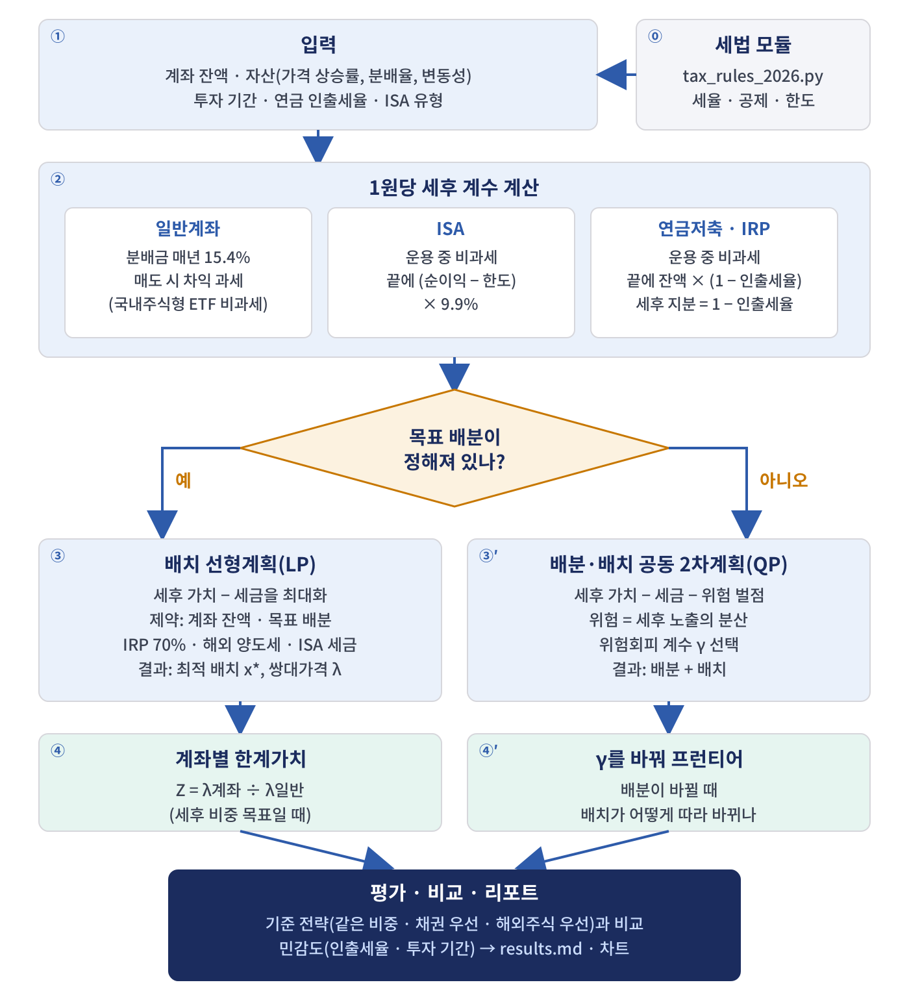

# 1. 계산 흐름

모델은 다섯 단계로 움직인다.

1. 계좌 잔액, 자산의 수익률·분배율·변동성, 투자 기간, 연금 인출세율을 입력하고 세법 모듈(`tax_rules_2026.py`)을 읽는다.
2. 계좌와 자산의 조합마다 1원을 넣었을 때 $T$년 뒤 세후 가치(1원당 세후 계수)를 계산한다.
3. 목표 배분이 정해져 있으면 배치 선형계획(LP)을, 정해져 있지 않으면 배분·배치 공동 2차계획(QP)을 푼다.
4. LP에서는 계좌 잔액 제약의 쌍대가격으로 계좌별 한계가치 $Z$를 얻고, QP에서는 위험회피 계수를 바꿔 가며 배분과 배치가 함께 움직이는 모습을 본다.
5. 기준 전략과 비교하고 민감도를 계산해 리포트를 만든다.

# 2. 기호

| 기호 | 뜻 |
|---|---|
| $a\in\mathcal{A}$ | 계좌: 일반, ISA, 연금저축, IRP |
| $i\in\mathcal{I}$ | 자산: 국내주식형 ETF, 국내상장 해외주식형 ETF, 해외상장 주식 ETF, 채권 ETF, 예금 |
| $x_{a,i}$ | 계좌 $a$에 담는 자산 $i$의 금액 (결정 변수, 만 원) |
| $W_a$ | 계좌 $a$의 잔액 |
| $T$ | 투자 기간 (년) |
| $g_i,\ d_i$ | 자산 $i$의 연 가격 상승률, 연 분배율 |
| $\tau_d=15.4\%$ | 배당소득세 (분배금, 국내상장 ETF 매매차익) |
| $\tau_f=22\%,\ D_f=250$ | 해외상장 주식 양도소득세율과 연 기본공제 (만 원) |
| $\tau_{I}=9.9\%,\ D_{I}$ | ISA 초과분 세율과 비과세 한도 (일반형 200, 서민형 400만 원) |
| $\tau_a$ | 연금계좌 $a$의 평가상 인출세율 (5.5%·4.4%·3.3%) |
| $n_a$ | 연금계좌 중 세액공제받지 않은 원금의 비중 |
| $\rho=70\%$ | IRP 위험자산 한도 |
| $\mathcal{R}$ | IRP 위험자산으로 분류되는 자산의 집합 |

# 3. 1원당 세후 계수

## 3.1 일반계좌

분배금은 매년 15.4%를 떼고 재투자하며, 재투자한 금액은 취득원가($B$)에 더한다. 처음에는 $V_0=B_0=1$이다.

$$ V_{t+1}=\underbrace{V_t(1+g_i)}_{\text{가격 상승}}+\underbrace{d_iV_t(1-\tau_d)}_{\text{세후 분배금 재투자}},\qquad B_{t+1}=B_t+d_iV_t(1-\tau_d) $$

$T$년 뒤 1원당 세후 가치 $v_{\text{일반},i}$는 상품의 과세 방식에 따라 다르다.

$$ v_{\text{일반},i}=\begin{cases}V_T & \text{국내주식형 ETF (매매차익 비과세)}\\ V_T-\tau_d\,(V_T-B_T) & \text{국내상장 해외주식형·채권 ETF, 예금}\\ V_T & \text{해외상장 ETF (양도세는 포트폴리오 단위로 따로 계산)}\end{cases} $$

해외상장 ETF의 1원당 양도차익은 $h_i=V_T-B_T$로 따로 기록한다.

## 3.2 ISA

운용 중에는 과세하지 않고, 기간 끝에 계좌 전체의 순이익에서 비과세 한도를 뺀 금액에 9.9%를 매긴다. 1원당 최종가치와 순이익은 다음과 같다.

$$ v_{\text{ISA},i}=(1+g_i+d_i)^T,\qquad k_i=v_{\text{ISA},i}-1 $$

## 3.3 연금저축·IRP

운용 중에는 과세하지 않고, 꺼낼 때 잔액에 평가상 인출세율을 적용한다. 세액공제받지 않은 원금은 꺼낼 때 과세하지 않는다.

$$ v_{a,i}=(1+g_i+d_i)^T\,(1-\tau_a)+\tau_a\,n_a $$

연금계좌의 위험 가운데 투자자가 실제로 지는 몫(세후 지분)은 $s_a=1-\tau_a$이고, 일반계좌와 ISA는 $s_a=1$로 둔다.

# 4. 배치 선형계획 (LP)

목표 배분이 정해져 있을 때 세후 최종가치를 최대화한다.

$$ \max_{x\ge0,\ t_f\ge0,\ t_I\ge0}\ \sum_{a,i}v_{a,i}\,x_{a,i}-\underbrace{t_f}_{\text{해외 양도세}}-\underbrace{t_I}_{\text{ISA 세금}} $$

제약은 다섯 가지다.

1. 계좌 잔액은 모두 투자한다.

   $$ \sum_{i}x_{a,i}=W_a\qquad(\text{쌍대가격 }\lambda_a) $$

2. 목표 배분을 맞춘다. 표시 잔액 기준이면 첫째 식, 세후 비중 기준이면 둘째 식을 쓴다.

   $$ \sum_{a}x_{a,i}=A_i\qquad\text{또는}\qquad \sum_{a}s_a\,x_{a,i}=w_i\sum_{a,j}s_a\,x_{a,j} $$

3. IRP 위험자산은 잔액의 70% 이하로 둔다.

   $$ \sum_{i\in\mathcal{R}}x_{\text{IRP},i}\le\rho\,W_{\text{IRP}} $$

4. 해외 양도세와 ISA 세금은 공제·한도를 넘는 부분에만 붙는다. 이 부등식과 최대화 목적이 함께 작동해 세금이 $\max(0,\cdot)$의 값으로 정해진다.

   $$ t_f\ge\tau_f\Big(\sum_i h_i\,x_{\text{일반},i}-D_f\Big),\qquad t_I\ge\tau_I\Big(\sum_i k_i\,x_{\text{ISA},i}-D_I\Big) $$

5. 계좌에 담을 수 없는 상품은 0이다. 해외상장 ETF는 ISA와 연금계좌에 담지 못한다.

   $$ x_{a,i}=0\qquad(a\in\{\text{ISA},\text{연금저축},\text{IRP}\},\ i=\text{해외상장 ETF}) $$

# 5. 계좌별 한계가치 $Z$

세후 비중 목표 아래에서 계좌 잔액 제약의 쌍대가격 $\lambda_a$는 그 계좌에 1원을 더 넣을 때 세후 최종가치가 얼마나 늘어나는지를 나타낸다. 이를 일반계좌 기준으로 나눈 것이 한계 환산계수다.

$$ \lambda_a=\frac{\partial\,(\text{세후 최종가치})}{\partial W_a},\qquad Z_a=\frac{\lambda_a}{\lambda_{\text{일반}}} $$

$Z_a>1$이면 그 계좌의 1원이 일반계좌의 1원보다 가치가 크다. 세금과 제약이 비선형이므로 계좌 전체 가치를 $Z_a\times W_a$로 구할 수는 없다. 새로 넣는 돈의 세액공제(13.2–16.5%)는 이 값에 포함하지 않는다.

# 6. 배분·배치 공동 2차계획 (QP)

목표 배분 없이, 세후 위험까지 고려해 배분과 배치를 함께 고른다. 자산 $i$의 세후 위험 노출과 위험 벌점은 다음과 같다.

$$ e_i=\sum_{a}s_a\,x_{a,i},\qquad \text{위험 벌점}=\frac{\gamma}{2}\cdot\frac{G\,T}{\bar W}\;e^{\top}\Sigma\,e $$

여기서 $\gamma$는 위험회피 계수, $\Sigma$는 자산 수익률의 연간 공분산 행렬, $G=(1+\bar r)^T$는 기준 수익률 $\bar r=5\%$로 잡은 성장 배수, $\bar W=\sum_a s_aW_a$는 세후 재산이다. 목적함수는 다음과 같다.

$$ \max_{x\ge0,\ t_f\ge0,\ t_I\ge0}\ \sum_{a,i}v_{a,i}\,x_{a,i}-t_f-t_I-\frac{\gamma}{2}\cdot\frac{G\,T}{\bar W}\;e^{\top}\Sigma\,e $$

제약은 LP의 1, 3, 4, 5번과 같고 목표 배분 제약(2번)은 없다.

이 벌점은 확실성 등가를 선형화한 근사에서 나온다. 최종 재산 $W_T$의 기대값과 분산을 $E[W_T]\approx G\bar W$, $\text{Var}(W_T)\approx G^2T\,e^{\top}\Sigma e$로 두면 다음이 된다.

$$ CE\approx E[W_T]-\frac{\gamma}{2}\cdot\frac{\text{Var}(W_T)}{E[W_T]}\approx E[W_T]-\frac{\gamma}{2}\cdot\frac{G\,T}{\bar W}\,e^{\top}\Sigma\,e $$

# 7. 평가

어떤 배치 $x$든 같은 식으로 세후 최종가치를 계산해 기준 전략과 비교한다.

$$ \text{세후 최종가치}(x)=\sum_{a,i}v_{a,i}x_{a,i}-\tau_f\max\Big(0,\sum_i h_ix_{\text{일반},i}-D_f\Big)-\tau_I\max\Big(0,\sum_i k_ix_{\text{ISA},i}-D_I\Big) $$

기준 전략은 계좌마다 같은 비중, 채권부터 절세계좌, 해외주식부터 절세계좌의 세 가지다.

# 8. 가정과 한계

- 기대 수익 경로를 따라 세금을 계산하는 결정론적 모델이다. 위험은 6절의 평균-분산 근사로만 반영한다.
- 국내상장 ETF는 과표기준가 상승분을 실제 매매차익과 같다고 둔다. 해외 원천징수, 금융소득종합과세(연 2,000만 원 초과), 거래비용, 수수료는 넣지 않았다.
- ISA는 기간 끝에 한 번 정산하고, 해외상장 ETF의 250만 원 공제도 한 번만 쓴다. 해마다 이익을 실현해 공제를 반복해 쓰는 전략은 들어 있지 않다.
- 연금은 평가상 인출세율 하나로 본다. 연금수령한도와 연 1,500만 원 기준은 따로 확인한다.
- 위험 노출에서 일반계좌와 ISA의 세금 위험 분담은 무시한다.
