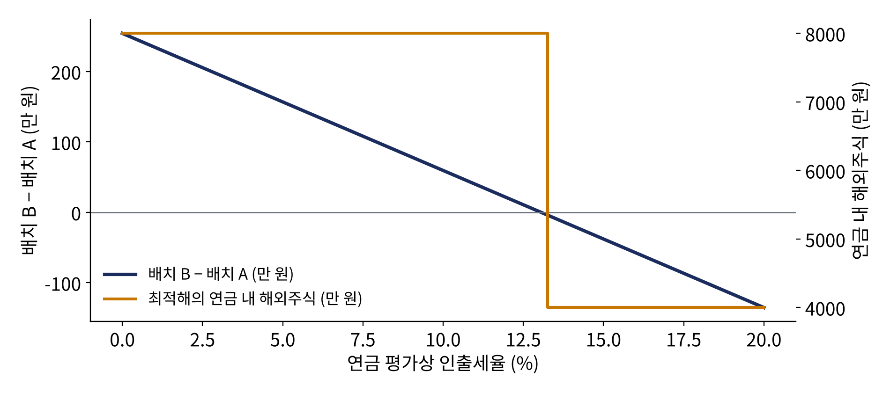
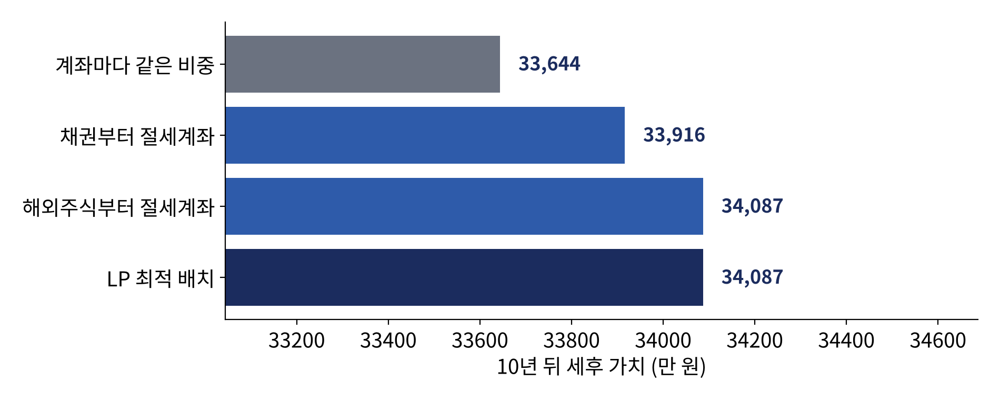
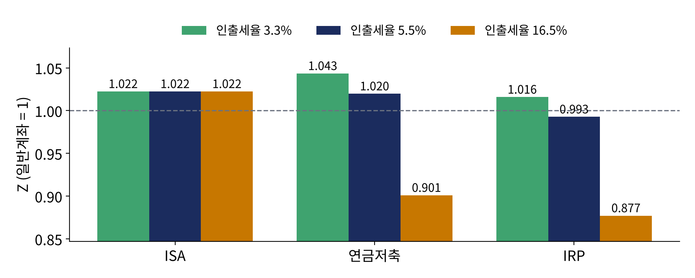
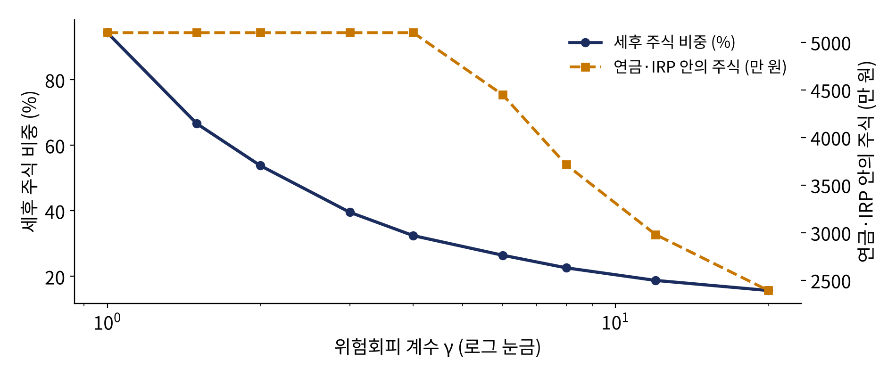

# 한국형 자산배분·자산배치 모델 — 실행 결과

금액 단위는 만 원, 투자 기간 10년, 기대 수익 경로 기준(결정론적)이다. 세법은 `tax_rules_2026.py`(2026년 11월 기준)를 따른다.

## 1. 검증 — 김 교수 사례 재현

일반계좌 1억·연금저축 1억, 국내주식 6,000·해외주식 8,000·채권 6,000(표시 잔액), 연금 평가상 인출세율 5.5%.

| 연금 인출세율 | 배치 A (채권부터 연금) | 배치 B (해외주식부터 연금) | LP 최적 | 최적해의 연금계좌 구성 |
|---|---:|---:|---:|---|
| 5.5% | 33,847 | 33,994 | 33,994 | 해외주식 8,000 · 채권 2,000 |
| 13.0% | 32,590 | 32,592 | 32,592 | 해외주식 8,000 · 채권 2,000 |
| 13.5% | 32,507 | 32,498 | 32,507 | 해외주식 4,000 · 채권 6,000 |
| 16.5% | 32,004 | 31,937 | 32,004 | 해외주식 4,000 · 채권 6,000 |

강의 자료의 값(A 33,847 · B 33,995 · 손익분기 약 13.1%)과 일치한다. LP는 인출세율 약 13.0~13.5% 사이에서 최적 배치를 '해외주식 우선'에서 '채권 우선'으로 바꾼다.

## 2. 4계좌 2억 원 — 기준 전략과 최적 배치

일반 1억 · ISA(일반형) 4,000만 · 연금저축 3,000만 · IRP 3,000만. 목표는 표시 잔액 기준 국내주식 6,000 · 해외주식 8,000 · 채권 6,000. 연금 인출세율 5.5%, ISA는 10년 뒤 한 번 정산(200만 원 비과세, 초과 9.9%), IRP 위험자산 70% 한도.

| 전략 | 10년 뒤 세후 가치 | 최적 대비 | ISA 세금 |
|---|---:|---:|---:|
| 계좌마다 같은 비중 | 33,644 | -443 | 284 |
| 채권부터 절세계좌 | 33,916 | -171 | 363 |
| 해외주식부터 절세계좌 | 34,087 | +0 | 310 |
| **LP 최적 배치** | **34,087** | 0 | 310 |

최적 배치(표시 잔액, 만 원):

| 계좌 | 국내주식형 ETF | 국내상장 해외주식형 ETF | 채권 ETF | 합계 |
|---|---:|---:|---:|---:|
| 일반 | 6,000 | — | 4,000 | 10,000 |
| ISA | — | 2,900 | 1,100 | 4,000 |
| 연금저축 | — | 3,000 | — | 3,000 |
| IRP | — | 2,100 | 900 | 3,000 |

## 3. 계좌별 한계가치 Z — 1원을 어느 계좌에 더 넣을까

세후 비중(국내 30 · 해외 40 · 채권 30)을 유지하면서 각 계좌에 1원을 더 넣었을 때 10년 뒤 세후 가치가 얼마나 늘어나는지(λ)를 LP의 쌍대가격으로 구하고, 일반계좌 대비 비율 Z = λ계좌 / λ일반을 계산한다. 새 납입의 세액공제는 포함하지 않는다.

| 연금 인출세율 | λ 일반 | λ ISA | λ 연금저축 | λ IRP | Z ISA | Z 연금저축 | Z IRP |
|---|---:|---:|---:|---:|---:|---:|---:|
| 3.3% | 1.689 | 1.727 | 1.763 | 1.716 | 1.022 | 1.043 | 1.016 |
| 5.5% | 1.689 | 1.727 | 1.722 | 1.677 | 1.022 | 1.020 | 0.993 |
| 16.5% | 1.689 | 1.727 | 1.522 | 1.482 | 1.022 | 0.901 | 0.877 |

λ는 '지금 1원 → 10년 뒤 세후 몇 원'이다. ISA는 비과세 한도 200만 원을 이미 넘긴 상태라 한계 세율 9.9%가 적용된다. 인출세율이 오르면 연금계좌의 Z가 1 아래로 떨어질 수 있다. 일하는 은퇴자가 새로 넣는 돈은 여기에 세액공제 13.2~16.5%가 더해진다.

## 4. 배분과 배치를 함께 — 위험회피 계수별 해

목적함수는 '세후 기대 최종가치 − (γ/2)·세후 위험 벌점'이다. 위험은 세후 노출(연금은 0.945만 내 몫)로 잰다. 변동성 국내 20% · 해외 17% · 채권 5%, 주식 간 상관 0.6, 주식-채권 상관 −0.1 (예시 가정).

| γ | 세후 주식 비중 | 국내 · 해외 · 채권 (세후 비중) | 연금·IRP 안의 주식 | ISA 구성 | 세후 기대가치 | 확실성 등가 |
|---:|---:|---|---:|---|---:|---:|
| 1 | 94% | 23 · 72 · 6 | 5,100 | 국내 0 · 해외 4,000 · 채권 0 | 36,194 | 32,438 |
| 1.5 | 67% | 16 · 50 · 33 | 5,100 | 국내 0 · 해외 4,000 · 채권 0 | 33,917 | 31,130 |
| 2 | 54% | 12 · 42 · 46 | 5,100 | 국내 0 · 해외 3,431 · 채권 569 | 32,867 | 30,378 |
| 3 | 40% | 9 · 30 · 60 | 5,100 | 국내 0 · 해외 1,156 · 채권 2,844 | 31,661 | 29,435 |
| 4 | 32% | 8 · 25 · 68 | 5,100 | 국내 0 · 해외 19 · 채권 3,981 | 31,058 | 28,793 |
| 6 | 26% | 5 · 21 · 74 | 4,448 | 국내 0 · 해외 0 · 채권 4,000 | 30,535 | 27,770 |
| 8 | 23% | 5 · 18 · 77 | 3,714 | 국내 0 · 해외 0 · 채권 4,000 | 30,173 | 26,908 |
| 12 | 19% | 4 · 14 · 81 | 2,980 | 국내 0 · 해외 0 · 채권 4,000 | 29,810 | 25,367 |
| 20 | 16% | 4 · 11 · 84 | 2,392 | 국내 0 · 해외 0 · 채권 4,000 | 29,520 | 22,501 |

읽는 법은 세 가지다.

1. **세금 순위는 위험 성향과 관계없이 유지된다.** 해외주식형 ETF는 언제나 연금·IRP를 먼저 채우고 그다음 ISA로 가며, 국내주식형 ETF는 일반계좌에 남는다. 위험 성향이 바꾸는 것은 순위가 아니라 각 자산의 양이다(Huang의 분리).
2. **주식 수요가 줄면 빈자리를 채권이 채운다.** γ가 커져 해외주식 수요가 연금 용량(연금저축 3,000 + IRP 2,100)보다 작아지면, 연금에도 채권이 들어간다. 그래도 일반계좌에 채권이 남는 것은 해외주식이 채권보다 절세계좌를 쓸 가치가 크기 때문이다.
3. **제약이 걸리면 배치가 왜곡된다.** γ = 1(주식 94%)에서 투자자는 거의 전부 주식을 원하지만, IRP 위험자산 70% 한도 때문에 IRP에 채권 900만 원이 강제로 들어간다. 그만큼 해외주식 5,293만 원이 세금 내는 일반계좌로 밀려난다. 위험을 과세계좌에서 마음대로 되돌릴 수 없다는 Huang 전제 ①이 깨진 모습이다.

γ = 1일 때 배치(표시 잔액, 만 원):

| 계좌 | 국내주식형 ETF | 국내상장 해외주식형 ETF | 채권 ETF | 합계 |
|---|---:|---:|---:|---:|
| 일반 | 4,443 | 5,293 | 263 | 10,000 |
| ISA | — | 4,000 | — | 4,000 |
| 연금저축 | — | 3,000 | — | 3,000 |
| IRP | — | 2,100 | 900 | 3,000 |

γ = 4일 때 배치(표시 잔액, 만 원):

| 계좌 | 국내주식형 ETF | 국내상장 해외주식형 ETF | 채권 ETF | 합계 |
|---|---:|---:|---:|---:|
| 일반 | 1,542 | — | 8,458 | 10,000 |
| ISA | — | 19 | 3,981 | 4,000 |
| 연금저축 | — | 3,000 | — | 3,000 |
| IRP | — | 2,100 | 900 | 3,000 |

γ = 12일 때 배치(표시 잔액, 만 원):

| 계좌 | 국내주식형 ETF | 국내상장 해외주식형 ETF | 채권 ETF | 합계 |
|---|---:|---:|---:|---:|
| 일반 | 877 | — | 9,123 | 10,000 |
| ISA | — | — | 4,000 | 4,000 |
| 연금저축 | — | 1,487 | 1,513 | 3,000 |
| IRP | — | 1,492 | 1,508 | 3,000 |

## 5. 같은 해외주식, 국내상장과 해외상장 중 어디로?

해외주식 8,000만 원을 국내상장 ETF(15.4%, 절세계좌 가능)와 해외상장 ETF(22%, 연 250만 원 공제, 일반계좌만 가능) 중 어떻게 나눌지도 모델이 고르게 한다. 두 상품의 기대수익은 같다고 둔다.

| 투자 기간 | 해외상장 ETF (일반계좌) | 국내상장 해외 ETF | 세후 가치 | 해외 양도세 |
|---|---:|---:|---:|---:|
| 3년 | 1,111 | 6,889 | 23,192 | 0 |
| 10년 | 258 | 7,742 | 34,122 | 0 |
| 20년 | 87 | 7,913 | 60,273 | 0 |

해외상장 ETF는 연 250만 원 공제가 있지만 모델은 투자 기간 전체에 한 번만 공제를 쓴다(매도를 마지막에 몰아서 하는 가정). 해마다 이익을 250만 원씩 실현해 공제를 반복해 쓰는 전략은 이 모델에 들어 있지 않으므로, 실제로는 해외상장 쪽이 더 유리할 수 있다.

## 6. 모델의 가정과 한계

- 기대 수익 경로를 따라 세금을 계산한다(결정론적). 시나리오별 위험은 4절의 평균-분산 근사로만 반영한다.
- 국내상장 ETF는 과표기준가 상승분을 실제 매매차익과 같다고 둔다. 해외 원천징수, 금융소득종합과세(연 2,000만 원 초과), 거래비용, 수수료는 넣지 않았다.
- ISA는 투자 기간 끝에 한 번 정산하고, 연금은 계좌 전체에 평가상 인출세율 하나를 곱한다(연금수령한도·연 1,500만 원 기준은 별도 확인).
- 위험 노출에서 일반계좌·ISA는 세금의 위험 분담을 무시하고(지분 1), 연금계좌만 1 − 인출세율로 잡는다.
- 수치는 2026년 11월 세법 기준의 예시이며 투자 권유가 아니다.